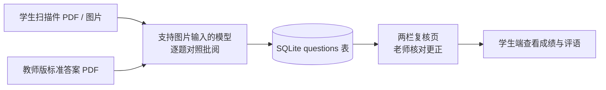

# GradeLogy — 作业管理与 AI 批改平台

面向老师、学生与教务管理者的轻量级教学系统，按「课程 → 讲次 / 考试」组织内容。讲次即一次作业：老师上传教师版标准答案 PDF，学生上传手写作答的扫描件，系统把「学生作业 + 标准答案」两份文件的整页图片一起交给多模态大模型逐题批阅；老师在「可编辑 OCR + 标准答案」两栏页面复核更正后发布成绩。考试只需录入分数与评语，不做 AI 批阅。不限定学科，凡有标准答案可对照的作业场景均可使用。

纯 Flask + SQLite 单体，无前端框架、无外部服务依赖（除 AI 接口），适合个人教师或小型机构自建部署。

## 角色与操作手册

| 角色 | 手册 | 主要能力 |
|------|------|----------|
| 管理员 admin | [管理员手册](docs/admin.md) | 建号与重置密码、数据导出/恢复、一致性检查、日志排查 |
| 老师 teacher | [老师手册](docs/teacher.md) | 课程、学生名单、讲次、标准答案、AI 批阅与复核、考试成绩录入 |
| 学生 student | [学生手册](docs/student.md) | 上传讲次作业、查看批改与考试成绩 |

## 功能概览

- **账号与权限**：admin / teacher / student 三角色；初始密码登录后强制修改；管理员可启用 / 停用账号（停用后无法登录，课程内也不再显示）；支持按姓名 CSV 批量建号（用户名按拼音自动生成）；账号列表可按用户名 / 角色 / 状态 / 创建时间 / 末次登录排序与筛选
- **课程与名单**：建课、选课；课程页只显示启用中的学生，移出学生需二次确认并在数据库层面删除其在本课程的全部记录；账号与名单导入由管理员负责
- **课程结构**：一门课程下管理若干讲次与若干场考试；讲次即一次作业，考试只记分数
- **讲次与讲义**：新建 / 编辑讲次（标题、说明、截止时间），每个讲次可上传「学生版讲义」与「教师版标准答案」两份 PDF；批阅时直接使用教师版，无需预处理
- **学生进度**：课程名单点进单个学生，查看其所有讲次的提交与得分、所有考试的成绩与评语（学生主数据与密码由管理员维护）
- **考试成绩**：按考试录入每个学生的分数与评语，保存即对学生可见
- **AI 批阅**：学生作业与标准答案两份文件整页渲染后一起送入多模态模型，逐题输出 OCR、判定（对 / 半对 / 错 / 无法判定）、得分与评语
- **人工复核**：两栏同屏，可修改 OCR、判定、得分与评语；保存即向学生发布
- **工程能力**：配置环境变量化、Docker 部署、日志轮转、每日自动备份、数据整体导出与恢复、一致性检查、访问与审计日志

## 架构

### 整份原卷批阅（不切题）

不再切题、不再裁剪图片，也不依赖 PDF 文字层。批阅时把两份文件的每一页渲染成图片，按顺序放进同一条消息交给模型：



- `utilities/pdfgrade.py`：用 pypdfium2 把每页渲染成 JPEG，按 OpenAI 兼容的 `image_url` content part 发送（约 1k~2k token/页）
- 模型一次输出逐题 JSON：题号、OCR、标准答案要点、判定、建议分数、评语，以及总评与薄弱点
- 输出被截断时自动抢救已完整的题目；模型没返回的题不会凭空补
- 单次批阅超时 300 秒且不重试，失败由老师手动重试，避免卡死请求占住线程
- 批阅结果写入 `questions` 表（`image_path` 留空），复核页只显示文字，不再展示裁剪图

### 技术栈

| 层 | 选型 |
|----|------|
| 后端 | Python 3.12 + Flask 3，Jinja2 模板，原生 CSS |
| 数据 | SQLite（WAL 模式），werkzeug 密码哈希 + Flask session |
| 文件读取 | pypdfium2 整页渲染为图片后发送，约 144dpi |
| 模型调用 | OpenAI 兼容 `/chat/completions`，urllib 直连，内置 429 退避与截断救援 |
| 部署 | gunicorn 单进程 8 线程，Docker / docker compose |

### 目录结构

```
GradeLogy/
├── app.py               # Flask 单体：路由 / 权限 / DB 迁移 / 批阅入口
├── config.py            # 配置中心：路径、端口、密钥、AI 全部走环境变量
├── utilities/           # pdfgrade（整份 PDF 批阅）/ roster / storage / llm
├── templates/           # 登录、三端页面、批阅复核页、系统维护
├── static/              # style.css
├── docs/                # 管理员 / 老师 / 学生操作手册
├── Dockerfile           # 单进程 gunicorn 多线程镜像，数据卷 /data
├── docker-compose.yml   # 一条命令起服务，数据落 ./data
├── data.sqlite          # 首次启动自动创建（已 gitignore）
├── logs/                # app.log，5MB 轮转（已 gitignore）
└── uploads/             # 学生提交与教师版 PDF（已 gitignore）
```

## 快速开始

```bash
# 1. 安装依赖（Python 3.10+）
pip install -r requirements.txt

# 2. 启动（首次启动自动建库、写入 admin 账号）
python app.py

# 3. 访问 http://127.0.0.1:5000
#    默认管理员：admin / admin123（登录后必须修改）
```

> macOS 系统 Python 若缺少 CA 证书，项目会自动用 `certifi` 兜底，避免调用 HTTPS AI 接口时报 SSL 错误。

## 文件存储

批阅不再生成任何切题图片，`uploads/` 只保存原件：

```
uploads/
├── <学生提交的 PDF / 图片>
└── <教师版标准答案 PDF>
```

OCR 文本、逐题判定与评语保存在数据库 `questions` 表；`questions.image_path` 留空。

## 部署与配置

```bash
docker compose up -d --build
```

国内网络拉不到 Docker Hub 时，取消 `docker-compose.yml` 里 `args.BASE_IMAGE` 的注释，或：

```bash
docker build --build-arg BASE_IMAGE=docker.m.daocloud.io/library/python:3.12-slim -t gradelogy .
```

- 数据统一落在 `./data`（容器内 `/data`），备份即拷走该目录
- 健康检查：`GET /healthz`（数据库与存储状态，异常返回 503）
- gunicorn 单进程 8 线程：SQLite 不适合多进程写入；批改长请求 `--timeout 1800`

所有部署参数集中在 `config.py`，均可用环境变量覆盖：

| 变量 | 默认值 | 说明 |
|------|--------|------|
| `DATA_DIR` | 项目目录 | 数据根目录，数据库/附件/日志默认都在其下 |
| `DB_PATH` | `$DATA_DIR/data.sqlite` | SQLite 文件路径 |
| `STORAGE_DIR` | `$DATA_DIR/uploads` | 上传件目录（学生作业与标准答案） |
| `LOG_DIR` | `$DATA_DIR/logs` | 日志目录（`app.log`，5MB 轮转 5 份） |
| `HOST` / `PORT` | `0.0.0.0` / `5000` | 监听地址与端口 |
| `MAX_UPLOAD_MB` | `20` | 单次上传上限 |
| `MAX_RESTORE_MB` | `2048` | 从备份恢复时解压总量上限 |
| `BACKUP_DIR` | `$DATA_DIR/backups` | 自动备份、手动备份与恢复前快照目录 |
| `BACKUP_KEEP` | `7` | 保留最近几份备份，超出的自动清理 |
| `AUTO_BACKUP` | `1` | 是否启用每日自动备份（`0` 关闭） |
| `SECRET_KEY` | 自动生成并存入 `$DATA_DIR/.secret_key` | 生产环境建议显式设置 |
| `AI_API_URL` / `AI_API_KEY` / `AI_MODEL` | 空 | 设置后优先于页面 AI 设置，容器部署不必把 Key 存库 |
| `LOG_LEVEL` | `INFO` | 日志级别；设为 `WARNING` 可关闭访问日志 |

## 数据备份与迁移

管理员「系统维护」提供完整备份与恢复：导出 zip（数据库在线快照 + 全部附件），在新系统上传即可整体还原。恢复前自动备份当前数据，恢复后重新登录；旧版本备份会自动执行数据库迁移。

全新安装（没有任何账号与课程数据）时，管理员首页会出现「系统初始化」卡片，可通过三步向导（`/setup`）直接导入备份 zip：先校验并预览包内账号 / 课程 / 附件数量，确认后才覆盖系统。已有数据时该向导自动关闭，改用「系统维护 → 从备份恢复」。

系统还会每天自动生成一份同样的完整备份到 `$DATA_DIR/backups`，保留最近 `BACKUP_KEEP` 份；管理员也可在「系统维护」页随时「立即备份」并下载历史备份。

同版本换目录也可直接停机拷贝整个数据目录（数据库与附件必须同源）。详细步骤、手动兜底与注意事项见 [管理员手册 · 备份与迁移](docs/admin.md#数据备份与迁移)。

## 路线图 / 已知限制

- [ ] 整份原卷一次请求，页数过多时受模型上下文与输出上限限制 → 计划支持分批批阅（按页分组，仍不做切题）
- [ ] 各模型对整页图片的 token 折算差异较大（实测 1k~2k/页），成本需按模型实测
- [ ] 批改结果导出 Excel
- [x] 学生名单 CSV 导入（已移除，改由管理员统一建号与维护名单）
- [x] 每日自动备份与一键下载
- [x] 局域网访问、Docker 部署与配置解耦
- [x] 系统数据整体导出、恢复、一致性检查与修复
- [x] 全新系统初始化导入向导（备份 zip 三步导入）
- [x] 访问日志、登录与账号审计、AI 调用日志

## 安全提示

- `data.sqlite`（含 API Key 与密码哈希）、`uploads/`、`.secret_key`、`logs/`、`backups/` 均在 `.gitignore` 中
- 部署到公网前请：修改默认 admin 密码、配置 HTTPS 反向代理、显式设置 `SECRET_KEY`、把 AI Key 改为环境变量注入
- 备份包含敏感信息，请按机密文件保管

## 许可证

本项目以 [MIT License](LICENSE) 发布，可自由使用、修改与再分发，保留版权声明即可。

### 数据合规

系统会保存学生学籍号、手写作答扫描件，并把这些材料通过图片形式发送给你配置的 AI 服务商。**部署者自行负责学生个人信息的安全与合规**，包括但不限于：

- 访问控制（强制改密、按班级授权、离职教师账号回收）
- 数据留存期限（毕业或课程结束后清理 `uploads/` 与数据库）
- 所用 AI 服务商的数据处理与留存条款，以及是否可用于训练
- 向学生及其监护人告知数据用途，遵守当地教育数据相关规定
