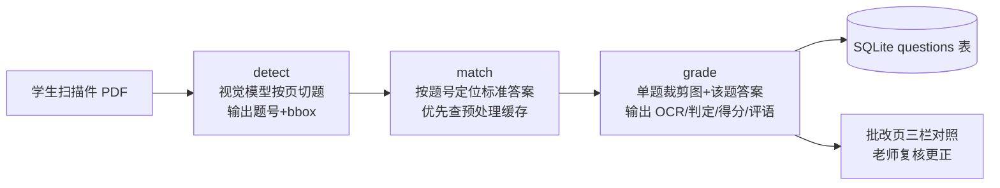

# GradeLogy — 化学竞赛作业管理与 AI 批改平台

面向化学竞赛老师 / 学生 / 教务管理者的轻量级在线作业系统：老师发布作业并上传教师版标准答案 PDF，学生通过网页上传手写作答的扫描件，系统调用视觉大模型完成「切题 → 答案定位 → 逐题批改」的全自动流水线，并在批改页提供「题目裁剪图 + 可编辑 OCR + 标准答案」三栏对照，供老师人工复核与更正。

全部代码无框架依赖（Flask 单体 + SQLite），开箱即用，适合个人教师或小型机构部署。

## 功能总览

| 角色 | 功能 |
|------|------|
| **管理员** admin | 创建 / 删除老师与学生账号、重置密码 |
| **老师** teacher | 创建课程、配置选课学生、发布作业（附标准答案 PDF）、协同教案、AI 接口设置（含连接测试与演示模式）、**提取标准答案**（教师版讲义一次性预处理）、AI 逐题批改、三栏批改页人工复核更正、**拖拽式批改流程设计器**、**错题本**（按课程查看全班错题，可按学生筛选） |
| **学生** student | 查看课程作业、上传扫描件（PDF / 图片）、查看逐题批改明细（判定 / 得分 / 评语 / 总评）、**错题本**（按课程汇总自己的错题） |

## 核心机制：三段式 AI 批改流水线

与「整卷一次扔给大模型」的做法不同，GradeLogy 把批改拆成三个小而稳的阶段，每个阶段都是 `utilities/` 下可独立运行、独立测试（POC）的工具节点：



- **detect** — 把扫描页渲染成图片，逐页（batch=1，避免空页拖累整批）交给视觉模型，返回每道题的题号与归一化坐标；空页静默跳过，纯字母子选项 `(a)(b)(c)` 不算独立题
- **match** — 用正则在教师版答案文本中按题号定位答案片段；若作业已执行过「提取标准答案」，直接命中预处理缓存，**不再重复解析教师版 PDF**
- **grade** — 按坐标裁剪单题小图，连同该题标准答案送视觉模型，输出严格 JSON：OCR 内容、对 / 半对 / 错判定、得分（含 max_score）、不超过 60 字的扣分说明

流水线由 `workflow.py` 执行器驱动（Kahn 拓扑排序，环引用 / 悬空节点会报明确错误），默认管线等价上述三段；老师也可以在设计器里自由编排。

## 快速开始

```bash
# 1. 安装依赖（Python 3.10+）
pip install -r requirements.txt
# flask / werkzeug / pillow / pypdfium2 / certifi

# 2. 启动（首次启动自动建库、写入 admin 账号）
python app.py

# 3. 访问
#    http://127.0.0.1:5000
#    默认管理员：admin / admin123（登录后请立即修改）
```

> macOS 系统 Python 若缺少 CA 证书，项目会自动尝试加载 `certifi` 兜底，避免调用 HTTPS AI 接口时报 SSL 错误。

## 使用指南

### 0. 管理员：建账号

`admin` 登录 → 用户管理 → 创建老师与学生账号（两类角色的登录后界面完全不同）。

### 1. 老师：建课程、配学生

老师登录 → 创建课程 → 在课程页勾选加入该课程的学生。

### 2. 老师：发布作业并上传标准答案

课程页发布作业（标题、说明、截止时间）→ 上传**教师版 PDF**（建议带文字层的讲义/答案版）。

### 3. 老师：提取标准答案（一次性预处理）

作业详情页点「**提取标准答案**」：

- 系统对教师版 PDF 做一次「切题 + 裁题目图 + 提取答案文本」，结果缓存进 `homework_questions` 表
- 题目图与页面图按 `课程/讲次/answer/` 归档到附件目录
- 之后**所有学生**的批改都直接复用这份缓存，换 PDF 后点「重新提取」覆盖

### 4. 老师：AI 设置

导航栏「AI 设置」：

- **接口地址**：任意 OpenAI 兼容服务，如腾讯 TokenHub `https://tokenhub.tencentmaas.com/v1`、智谱 `https://open.bigmodel.cn/api/paas/v4` 等
- **API Key**：留空提交 = 保持原值不变
- **模型**：需为**视觉模型**（能读图片），如 `hunyuan-t1-vision-20250916`、`glm-4v-flash`
- **演示模式**：未配 Key 时打开，按页等分生成占位题目，可先走通全流程
- 页面提供「测试连接」按钮与服务商对照表

### 5. 学生：上传作业

学生登录 → 课程 → 作业 → 上传手写作答的扫描 PDF（≤20MB）。

### 6. 老师：AI 批改 + 人工复核

作业详情 → 提交记录 → 「AI 批改」：

1. 自动走批改流水线（约 30-60 秒/题，取决于模型与题量）
2. 完成后进入批改页：左侧题目裁剪图、中间 OCR 文本框（**可手动修正**）、右侧标准答案，同屏三栏
3. 每题显示判定徽标（对=绿 / 半对=橙 / 错=红）、AI 建议得分与评语
4. 老师可修改任意题的判定、得分与评语后「发布成绩」，学生端即可查看（判定同时决定该题是否进入错题本）

## 错题本

导航栏「错题本」按课程汇总学生被判「错」「半对」的题目，只统计已发布（状态为「已批改」）的提交：

- **老师**：看到自己每门课的错题总数与涉及学生数，进入课程后可按学生筛选；每条错题可查看学生作答裁剪图、OCR、评语、标准答案，并跳回原批改页
- **学生**：只看到自己的错题，按课程分组，便于集中复习
- **状态追踪**：每条错题有「待复习 / 已掌握」状态与复习次数；老师和学生本人都可「复习 +1」「标记已掌握」「恢复待复习」，列表可按状态筛选

错题记录直接来自 `questions` 表的判定结果，不额外建表；老师在批改页修正判定后，错题本随之更新。状态与复习次数存在 `questions.wrong_status / review_count / reviewed_at`。

查询逻辑独立在 `utilities/wrongbook.py`（纯函数，不依赖 Flask），可脱开网页直接核对：

```bash
python -m utilities.wrongbook --teacher 1          # 某老师各课程汇总
python -m utilities.wrongbook --course 1           # 课程错题明细
python -m utilities.wrongbook --course 1 --status pending --student 3
python -m utilities.wrongbook --student-user 4     # 学生视角汇总
```

## 自定义批改流程（拖拽设计器）

导航栏「批改流程」进入设计器（基于 [Drawflow](https://github.com/jerosoler/Drawflow) 本地化，无 CDN 依赖）：

1. 左侧面板列出 `utilities/manifest.json` 注册的所有节点（detect / match / grade…）
2. 拖入画布、连线、点选节点编辑参数（如 grade 的 `max_tokens`、match 的 `window`）
3. 保存为命名流程 → 在作业详情页「使用流程」下拉中绑定 → 该作业的批改即走自定义图

### 新增一个工具节点（开发者）

```bash
utilities/
├── llm.py          # 公共底座：chat() / extract_json() / resolve_config()
├── detect.py       # 切题节点 + pdf_to_pages() / crop_bbox()
├── match.py        # 答案定位节点 + load_answer_text()
├── grade.py        # 逐题判分节点
├── prepare.py      # 教师版讲义预处理节点（切题+裁图+提取答案）
├── storage.py      # 附件目录/安全文件名
├── wrongbook.py    # 错题本查询（纯函数 + CLI，非流水线节点）
└── manifest.json   # 节点注册表 → 设计器面板由此渲染
```

三步接入：

1. 在 `utilities/` 下新建模块，实现处理函数（输入取自流程 state，输出写回 state）
2. 在 `workflow.py` 的 `NODE_RUNNERS` 注册
3. 在 `manifest.json` 增加条目（label / desc / inputs / outputs / params），设计器面板自动出现新节点

### 工具节点 CLI 独立测试（POC）

每个节点都可脱离 Web 单独跑通真实 API：

```bash
# 切题：识别第 1 页的题目位置
python -m utilities.detect --pdf uploads/test_stu.pdf --pages 1

# 答案定位：在教师版 PDF 中找 3.1 的答案
python -m utilities.match --no 3.1 --pdf uploads/test_ans.pdf

# 教师版预处理：切题 + 裁图 + 提取全部标准答案
python -m utilities.prepare --pdf uploads/test_ans.pdf --pages 16
```

## 附件存储结构

所有渲染页与裁剪图按「课程 / 讲次 / 学生」确定性命名归档，**重跑自动覆盖，不产生碎片**：

```
uploads/
├── <原始提交 PDF>                       # 学生上传原件
└── attachments/
    └── 水溶液中的反应（AI测试）/          # 课程名
        └── 第16讲_作业/                  # 作业标题
            ├── amber_p1.jpg ~ p10.jpg    # detect 渲染的整页图
            ├── amber_q_3.1.jpg …         # crop 的单题图（{学生}_q_{题号}）
            └── answer/
                ├── ans_p1.jpg …          # 教师版渲染页
                └── ans_q_3.1.jpg …       # 教师版题目裁剪图
```

## 项目结构

```
GradeLogy/
├── app.py               # Flask 单体：路由 / 权限 / DB 迁移 / 批改入口
├── config.py            # 配置中心：路径、端口、密钥、AI 全部走环境变量
├── workflow.py          # 流程执行器：拓扑排序 + 默认管线 + 节点调度
├── utilities/           # 工具节点库（见上文）
├── templates/           # Jinja2 模板：登录 / 三端页面 / 批改页 / 流程设计器 / 系统维护
├── static/
│   ├── style.css
│   └── vendor/          # drawflow.min.js / drawflow.min.css（本地化）
├── Dockerfile           # 单进程 gunicorn 多线程镜像，数据卷 /data
├── docker-compose.yml   # 一条命令起服务，数据落 ./data
├── data.sqlite          # 首次启动自动创建（已 gitignore）
├── logs/                # app.log，5MB 轮转（已 gitignore）
└── uploads/             # 学生提交与批改附件（已 gitignore）
```

## 数据模型

| 表 | 用途 |
|----|------|
| users | 账号（admin / teacher / student），werkzeug 哈希密码 |
| courses / enrollments | 课程与选课关系 |
| homeworks | 作业（含 answer_pdf、pipeline_id 绑定自定义流程） |
| submissions | 学生提交（状态、AI 汇总 JSON、教师终审） |
| questions | 逐题批改记录（页码、裁剪图路径、OCR、判定、得分、评语） |
| homework_questions | **教师版标准答案缓存**（提取一次，批改复用） |
| lesson_plans | 协同教案 |
| settings | 每位老师的 AI 接口配置（key-value） |
| pipelines | 拖拽设计器保存的流程图（graph_json） |

## AI 接入说明

- **协议**：OpenAI 兼容 `/chat/completions`，图片以 base64 data-URL 内联
- **实测经验**（腾讯 TokenHub）：
  - 优先选**视觉模型**且注意思考型模型的 `max_tokens`：如 glm-5v-turbo 属思考模型，`max_tokens=1500` 会被推理耗尽导致空输出，建议 ≥6000
  - `detect` 输出极小（题号+坐标），`max_tokens=3000` 足够；`batch=1` 单页检测最稳，多页混入空页易被模型整批跳过
- **429 / 限流**：内置指数退避重试（3 次）
- **截断救援**：输出 JSON 被截断时按括号配对尝试抢救（`_salvage_questions`）

## 路线图 / 已知限制

- [ ] grade 阶段串行调用，44 题约 15-20 分钟 → 计划引入并发（ThreadPoolExecutor）
- [ ] 混元视觉模型单页偶发漏题（可调 detect 提示词或多轮投票）
- [ ] 批量导入学生名单（CSV）
- [ ] 批改结果导出 Excel
- [x] 局域网访问（默认监听 `0.0.0.0`，启动时打印手机可用的地址）
- [x] Docker 部署与配置解耦
- [x] 系统数据整体导出、数据一致性检查与修复
- [x] 从导出包恢复数据（自动备份当前数据）

## 配置项（环境变量）

所有部署参数集中在 `config.py`，均可用环境变量覆盖；不设置时行为与本地开发一致。

| 变量 | 默认值 | 说明 |
|------|--------|------|
| `DATA_DIR` | 项目目录 | 数据根目录，数据库/附件/日志默认都在其下 |
| `DB_PATH` | `$DATA_DIR/data.sqlite` | SQLite 文件路径 |
| `STORAGE_DIR` | `$DATA_DIR/uploads` | 上传件与批改附件目录 |
| `LOG_DIR` | `$DATA_DIR/logs` | 日志目录（`app.log`，5MB 轮转保留 5 份） |
| `HOST` / `PORT` | `0.0.0.0` / `5000` | 监听地址与端口 |
| `MAX_UPLOAD_MB` | `20` | 单次上传上限（学生作业等） |
| `MAX_RESTORE_MB` | `2048` | 备份包上传与解压后的总大小上限，防止恶意 zip 撑爆磁盘 |
| `SECRET_KEY` | 自动生成并存入 `$DATA_DIR/.secret_key` | 会话签名密钥，生产环境建议显式设置 |
| `AI_API_URL` / `AI_API_KEY` / `AI_MODEL` | 空 | 设置后优先于页面上的 AI 设置，容器部署不必把 Key 存库 |
| `LOG_LEVEL` | `INFO` | 日志级别 |

## Docker 部署

```bash
docker compose up -d --build
```

> 国内网络拉不到 Docker Hub 时，先取消 `docker-compose.yml` 里 `args.BASE_IMAGE` 的注释，
> 或手动指定：`docker build --build-arg BASE_IMAGE=docker.m.daocloud.io/library/python:3.12-slim -t gradelogy .`

- 数据统一落在 `./data`（容器内挂载为 `/data`），备份就是拷走这个目录
- 健康检查：`GET /healthz`，返回数据库与存储状态（异常时 503）
- 容器内用 gunicorn 单进程 8 线程运行：SQLite 不适合多进程写入，单进程多线程可兼顾并发与数据安全
- 批改是长耗时同步请求，`--timeout 1800` 避免被 worker 杀

## 数据导出与一致性检查

管理员登录后进入「系统维护」：

- **导出全部数据**：生成 zip（数据库在线快照 + 全部附件 + `manifest.json`），用于备份或换机迁移
- **从备份恢复**：上传 zip → 校验包结构与路径安全 → 自动备份当前数据到 `<数据目录>/backups/` → 替换附件并覆盖数据库；恢复完成后需重新登录
- **一致性检查**：比对数据库记录与磁盘文件，报告孤儿题目、丢失的裁剪图/PDF、失效的流程绑定
- **执行安全修复**：只清理孤儿记录与失效流程绑定；文件丢失类问题只报告、不自动删除，避免误删数据

## 安全提示

- `data.sqlite`（含 API Key 与密码哈希）、`uploads/`、`.secret_key`、`logs/` 均在 `.gitignore` 中，不会进入仓库
- 所有写操作（POST/PUT/PATCH/DELETE）启用 CSRF 校验：表单需带隐藏域 `_csrf`（Jinja 里写 `{{ csrf_token() }}`），fetch 请求带请求头 `X-CSRF-Token`；漏带会直接 400
- 仍在使用初始密码（`admin123` / `123456`）的账号，登录后只能进入改密页，改完才能使用其他功能
- 学生只能访问自己提交的原件与本人提交下的裁剪图，教师版答案与其他学生的文件一律 403
- 部署到公网前请：修改默认 admin 密码、配置 HTTPS 反向代理、显式设置 `SECRET_KEY`、把 AI Key 改为环境变量注入
