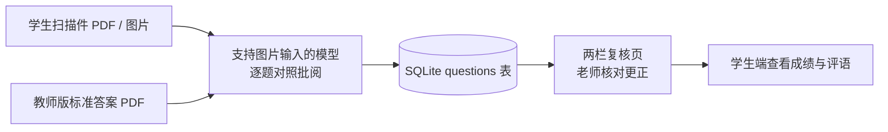

<p align="center">
  
</p>

# GradeLogy — 作业管理与 AI 批改平台

面向老师、学生与教务管理者的轻量级教学系统，按「课程 → 讲次 / 考试」组织内容。讲次即一次作业：老师上传教师版标准答案 PDF，学生上传手写作答的扫描件，系统把「学生作业 + 标准答案」两份文件的整页图片一起交给多模态大模型逐题批阅；老师在「可编辑 OCR + 标准答案」两栏页面复核更正后发布成绩。考试只需录入分数与评语，不做 AI 批阅。不限定学科，凡有标准答案可对照的作业场景均可使用。

纯 Flask + SQLite 单体，无前端框架、无外部服务依赖（除 AI 接口），适合个人教师或小型机构自建部署。

## 项目亮点：不止 AI 批改

AI 批改是入口，GradeLogy 更重要的价值是把批改结果变成可追溯、可协作、可运营的教学数据：

| 延展能力 | 说明 |
| --- | --- |
| **学科知识图谱** | 教材 / 考纲 / 讲义自动沉淀为概念与前置关系；所有教师可浏览并关联到有权限的课程，图谱编辑仍按协作权限控制。支持防环、体检、治理建议和运营指标。 |
| **根因分析底座** | 知识点标签的横向 / 纵向分析与图谱前置关系结合，目标是从「这题错了」走到「哪个前置概念没掌握」。 |
| **全角色数字助手** | 管理员、老师、学生有各自的只读助手与工具；老师课程数据范围受 `TEMPORARY_GLOBAL_TEACHER_ACCESS` 控制（默认开启全局访问，生产隔离部署应设为 `0`）。 |
| **MCP 只读工具集** | 内置 17 个教师 MCP 工具，可查询课程、讲次、成绩、批阅状态、AI 用量和操作手册；服务用固定教师账号启动，不含写操作。 |
| **可运维的单体** | 每日自动备份、整站导出恢复、一致性检查、日志轮转、Docker 部署，数据与附件同源迁移。 |

知识图谱的设计取舍、当前进度与后续路线见 [知识图谱模块说明](docs/knowledge_graph.md)。

## 开发与二次开发

本项目通过字节跳动 [Trae](https://www.trae.cn/) 工具协同开发完成。欢迎 Fork 后继续增强；使用 Trae、Claude Code 或 OpenAI Codex 接手开发时，可参考 [AI 辅助二次开发指南](docs/ai-development.md)。

代码审阅和 UI 方案记录属于历史档案；当前教师操作以老师手册及[流程与前置条件](docs/teacher-workflows.md)为准。

## 角色与操作手册

各角色操作手册说明当前可用功能、操作步骤与前置条件；完整流程以对应角色手册及老师流程表为准。

快速走通建课、收作业、批阅、发布与学生复习，可从[新手上手指南](docs/quick-start.md)开始。

| 角色 | 手册 | 主要能力 |
|------|------|----------|
| 管理员 admin | [管理员手册](docs/admin.md) | 建号与重置密码、数据导出/恢复、一致性检查、日志排查 |
| 老师 teacher | [老师手册](docs/teacher.md) · [流程前置条件](docs/teacher-workflows.md) | 课程、名单、作业批阅与报告发布、知识图谱、考试 |
| 学生 student | [学生手册](docs/student.md) | 上传讲次作业、查看批改与考试成绩 |

角色手册用于查各自的操作流程、前置条件和异常场景。

## 功能概览

- **账号与权限**：admin / teacher / student 三角色；初始密码登录后强制修改；管理员可启用 / 停用账号（停用后无法登录，课程内也不再显示）；支持按姓名 CSV 批量建号（用户名按拼音自动生成）；账号列表可按用户名 / 角色 / 状态 / 创建时间 / 末次登录排序与筛选
- **课程与名单**：建课、选课；课程页只显示启用中的学生，移出学生需二次确认并在数据库层面删除其在本课程的全部记录；账号与名单导入由管理员负责
- **课程结构**：一门课程下管理若干讲次与若干场考试；讲次即一次作业，考试只记分数
- **讲次与讲义**：新建 / 编辑讲次（标题、说明、截止时间），每个讲次可上传「学生版讲义」与「教师版标准答案」两份 PDF；批阅时直接使用教师版，无需预处理
- **学生进度**：课程名单点进单个学生，查看其所有讲次的提交与正确率、所有考试的成绩与评语（学生主数据与密码由管理员维护）
- **考试成绩**：按考试录入每个学生的分数与评语，保存即对学生可见
- **AI 批阅**：学生作业与标准答案两份文件整页渲染后一起送入多模态模型，逐题输出 OCR、判定（对 / 半对 / 错 / 无法判定）与评语，并按判定统计正确率
- **知识点标签与薄弱点分析**：保存作业范围不会调用 AI 或自动生成标签；教师可单独生成/编辑标签。完成批阅后可按标签做横向分析（同一讲全班共性问题）与纵向分析（同一学生跨讲次反复出错的知识点）。两类分析均有系统默认提示词，可复制 / 编辑，并在课程页按课程选择
- **学科知识图谱**：上传教材、考纲或讲义，由 AI 增量抽取概念和关系；支持分层可视化、出处追踪、防环、体检、分类及协作权限。回滚须通过状态校验，避免覆盖后续成果。详见 [知识图谱模块说明](docs/knowledge_graph.md)。
- **Digital Assistant 数字助手**：管理员、教师、学生登录后都有角色对应的助手，可用自然语言查询各自可见的数据并检索本角色正式手册；历史维护记录、设计草案和其他角色手册不参与操作步骤检索。数据查询按角色和归属过滤，只读；助手对话不进入 AI 用量、模型请求或应用访问日志。
- **MCP 服务目录**：内置 `mcp_server.py`（stdio），可向 Trae、Claude Desktop、Cursor 等 MCP 客户端开放 `ask_help`、`list_courses`、`list_lectures`、`lecture_status`、`find_student`、`student_report`、`list_exams`、`exam_scores`、`course_overview`、`pending_work`、`grading_queue`、`search_reports`、`ai_usage`、`list_prompts`、`get_prompt`、`lesson_plan`、`lecture_scope` 17 个只读工具；仅允许教师账号，不提供写操作。`GRADELOGY_TEACHER` 固定该 MCP 进程的教师身份；`TEMPORARY_GLOBAL_TEACHER_ACCESS` 默认为开启，设为 `0` 后按课程成员关系过滤。接入前请评估学生成绩等数据是否可提供给该 MCP 客户端
- **人工复核与报告发布**：复核页逐题自动保存；全部题目复核后生成报告。报告页的一键发布同时公开报告、逐题结果和学生错题/薄弱点数据；复核完成本身不公开。重新批阅时先隐藏旧结果
- **工程能力**：配置环境变量化、Docker 部署、日志轮转、每日自动备份、数据整体导出与恢复、一致性检查、访问与审计日志

## 架构

### 整份原卷批阅（不切题）

不再切题、不再裁剪图片，也不依赖 PDF 文字层。批阅时把两份文件的每一页渲染成图片，按顺序放进同一条消息交给模型：



- `utilities/pdfgrade.py`：用 pypdfium2 把每页渲染成 JPEG，按 OpenAI 兼容的 `image_url` content part 发送（约 1k~2k token/页）
- 模型一次输出逐题 JSON：题号、OCR、标准答案要点、判定、建议分数、评语，以及总评与薄弱点
- 输出被截断时自动抢救已完整的题目；模型没返回的题不会凭空补
- 单次批阅超时 300 秒且不重试，失败由老师手动重试，避免卡死请求占住线程
- 批阅结果写入 `questions` 表；复核页可查看原页和题目定位框，对照文字更正结果，无需提前裁剪图片

### 技术栈

| 层 | 选型 |
|----|------|
| 后端 | Python 3.12 + Flask 3，Jinja2 模板，原生 CSS |
| 数据 | SQLite（WAL 模式），werkzeug 密码哈希 + Flask session |
| 文件读取 | pypdfium2 整页渲染为图片后发送，约 144dpi |
| 模型调用 | OpenAI 兼容 `/chat/completions`，urllib 直连，内置 429 退避与截断救援 |
| 部署 | gunicorn 单进程 8 线程，Docker / docker compose |

### 目录结构

```
GradeLogy/
├── app.py               # 应用工厂、路由与业务入口；导入不迁移或启动后台任务
├── wsgi.py              # 生产入口：显式迁移数据库并启动后台服务
├── db.py                # 数据库连接、Schema 与兼容迁移
├── config.py            # 配置中心：路径、端口、密钥、AI 全部走环境变量
├── utilities/           # pdfgrade（整份 PDF 批阅）/ knowledge_graph / kg_text / roster / storage / llm
├── templates/           # 登录、三端页面、批阅复核页、系统维护
├── static/              # style.css 与页面交互脚本（ui.js、teacher_ui.js、assistant.js 等）
├── docs/                # 管理员 / 老师 / 学生操作手册
├── Dockerfile           # 单进程 gunicorn 多线程镜像，数据卷 /data
├── docker-compose.yml   # 一条命令起服务，数据落 ./data
├── data.sqlite          # 首次启动自动创建（已 gitignore）
├── logs/                # app.log，5MB 轮转（已 gitignore）
└── uploads/             # 学生提交与教师版 PDF（已 gitignore）
```

## 部署指南

- [单机简易部署（Windows / macOS）](docs/deploy-standalone.md)：无需技术背景，使用 Docker Desktop 在自己的电脑上运行。
- [腾讯云部署与自动发布](docs/deploy-tencent.md)：面向 Fork 用户，包含服务器初始化、GitHub Actions 自动部署、数据持久化与常见报错处理。

## 文件存储

批阅不再生成任何切题图片，`uploads/` 只保存原件，并按课程 / 讲次 / 学生分层：

```
uploads/
└── course_<课程 id>/
    └── lecture_<讲次 id>/
        ├── <教师版标准答案 PDF>
        ├── <学生版讲义 PDF>
        └── student_<学生 id>/
            └── <该生提交的 PDF / 图片>
```

旧版本平铺在 `uploads/` 根目录的附件会在启动（或从旧备份恢复）时自动迁入上述结构并更新数据库引用；迁移是幂等的，可反复启动。

OCR 文本、逐题判定与评语保存在数据库 `questions` 表；`questions.image_path` 留空。

## 数据备份与迁移

管理员「系统维护」提供完整备份与恢复：导出 zip（数据库在线快照 + 全部附件），在新系统上传即可整体还原。恢复前自动备份当前数据，恢复后所有浏览器的旧登录失效，须重新登录；旧版本备份会自动执行数据库迁移。

全新安装（没有任何账号与课程数据）时，管理员首页会出现「系统初始化」卡片，可通过三步向导（`/setup`）直接导入备份 zip：先校验并预览包内账号 / 课程 / 附件数量，确认后才覆盖系统。已有数据时该向导自动关闭，改用「系统维护 → 从备份恢复」。

系统还会每天自动生成一份同样的完整备份到 `$DATA_DIR/backups`，保留最近 `BACKUP_KEEP` 份；管理员也可在「系统维护」页随时「立即备份」并下载历史备份。

同版本换目录也可直接停机拷贝整个数据目录（数据库与附件必须同源）。详细步骤、手动兜底与注意事项见 [管理员手册 · 备份与迁移](docs/admin.md#数据备份与迁移)。

## 路线图 / 已知限制

- [ ] 完善根因联动：已有标签与前置关系辅助分析，后续增加教师确认和复习路径闭环
- [x] 教师端任务布局：课程/讲次优先，宽屏批阅工作区、手机单题复核和图谱浏览分区
- [ ] 班级/讲次概念覆盖热力图与复测反馈（错题本、薄弱点和复习状态已有）
- [ ] 图谱质量治理自动化：高置信同名合并、孤立节点下线一键应用，体检定时执行
- [ ] 图谱 GraphML 导入导出与版本差异对比（JSON 迁移包已支持）
- [ ] 整份原卷一次请求，页数过多时受模型上下文与输出上限限制 → 计划支持分批批阅（按页分组，仍不做切题）
- [ ] 各模型对整页图片的 token 折算差异较大（实测 1k~2k/页），成本需按模型实测
- [ ] 批改结果导出 Excel
- [x] 知识图谱增量建图、防环、成环报告、关系反向 / 删除、AI 体检与快照回滚
- [x] 知识图谱三级协作权限与空间 / 耗时 / Token 运营指标
- [x] 管理员 CSV 批量建号与教师课程名单维护
- [x] 每日自动备份与一键下载
- [x] 局域网访问、Docker 部署与配置解耦
- [x] 系统数据整体导出、恢复、一致性检查与修复
- [x] 全新系统初始化导入向导（备份 zip 三步导入）
- [x] 访问日志、登录与账号审计、AI 调用日志

## 安全提示

- `.env`、`data.sqlite`（含 API Key 与密码哈希）、`uploads/`、`.secret_key`、`logs/`、`backups/` 均在 `.gitignore` 中
- 首次登录后必须修改默认 admin 密码
- 备份包含敏感信息，请按机密文件保管

## 许可证

本项目以 [MIT License](LICENSE) 发布，可自由使用、修改与再分发，保留版权声明即可。

### 数据合规

系统会保存学生学籍号、手写作答扫描件，并把这些材料通过图片形式发送给你配置的 AI 服务商。**部署者自行负责学生个人信息的安全与合规**，包括但不限于：

- 访问控制（强制改密、按班级授权、离职教师账号回收）
- 数据留存期限（毕业或课程结束后清理 `uploads/` 与数据库）
- 所用 AI 服务商的数据处理与留存条款，以及是否可用于训练
- 向学生及其监护人告知数据用途，遵守当地教育数据相关规定
