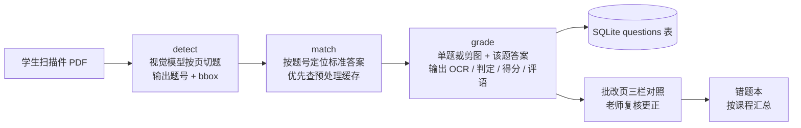

# GradeLogy — 作业管理与 AI 批改平台

面向老师、学生与教务管理者的轻量级在线作业系统。老师发布作业并上传教师版标准答案 PDF，学生上传手写作答的扫描件，系统调用视觉大模型按「切题 → 定位答案 → 逐题批改」流水线处理；老师在「题目裁剪图 + 可编辑 OCR + 标准答案」三栏页面复核更正后发布成绩，错题自动进入按课程组织的错题本。不限定学科，凡支持 PDF / 图片作答与标准答案对照的场景均可使用。

纯 Flask + SQLite 单体，无前端框架、无外部服务依赖（除 AI 接口），适合个人教师或小型机构自建部署。

## 角色与操作手册

| 角色 | 手册 | 主要能力 |
|------|------|----------|
| 管理员 admin | [管理员手册](docs/admin.md) | 建号与重置密码、数据导出/恢复、一致性检查、日志排查 |
| 老师 teacher | [老师手册](docs/teacher.md) | 课程、学生名单、作业、标准答案、AI 批改与复核、错题本、流程设计器 |
| 学生 student | [学生手册](docs/student.md) | 上传作业、查看批改、错题本复习 |

## 功能概览

- **账号与权限**：admin / teacher / student 三角色；初始密码登录后强制修改
- **课程与名单**：建课、选课；CSV 批量导入学生或一次批量建课，上传后先预览再确认，已有账号直接入课，新用户名自动建号
- **作业与答案**：发布作业、上传教师版 PDF；标准答案一次性提取并缓存，之后批改不再重复解析 PDF
- **AI 批改**：detect（按页切题）→ match（按题号定位答案）→ grade（单题判分），输出 OCR、判定（对 / 半对 / 错 / 无法判定）、得分与评语
- **人工复核**：三栏同屏，可修改 OCR、判定、得分与评语；保存即向学生发布
- **错题本**：按课程汇总，老师可按学生筛选，学生只看自己；支持「待复习 / 已掌握」与复习次数
- **可编排流程**：Drawflow 拖拽设计器，作业可绑定自定义批改流程
- **工程能力**：配置环境变量化、Docker 部署、日志轮转、每日自动备份、数据整体导出与恢复、一致性检查、访问与审计日志

## 架构

### 三段式批改流水线

与「整卷一次扔给大模型」不同，批改被拆成三个小而稳的阶段，每个阶段都是 `utilities/` 下可独立运行、独立测试的工具节点：



- **detect**：逐页渲染为图片交给视觉模型，只返回题号与归一化坐标；空页自动跳过
- **match**：用正则在教师版答案文本中定位；若作业已执行「提取标准答案」，直接命中缓存
- **grade**：按坐标裁剪单题图，与标准答案一起送模型，输出严格 JSON；教师未给满分时不给编造分值

流水线由 `workflow.py` 驱动（Kahn 拓扑排序，环引用 / 悬空节点会明确报错），默认管线即上述三段；老师也可以在设计器中自由编排。

### 技术栈

| 层 | 选型 |
|----|------|
| 后端 | Python 3.12 + Flask 3，Jinja2 模板，原生 CSS |
| 数据 | SQLite（WAL 模式），werkzeug 密码哈希 + Flask session |
| PDF / 图像 | pypdfium2 渲染与文字层提取，Pillow 按 bbox 裁剪 |
| 模型调用 | OpenAI 兼容 `/chat/completions`，urllib 直连，内置 429 退避与截断救援 |
| 流程设计器 | Drawflow 0.0.59（本地化，无 CDN 依赖） |
| 部署 | gunicorn 单进程 8 线程，Docker / docker compose |

### 目录结构

```
GradeLogy/
├── app.py               # Flask 单体：路由 / 权限 / DB 迁移 / 批改入口
├── config.py            # 配置中心：路径、端口、密钥、AI 全部走环境变量
├── workflow.py          # 流程执行器：拓扑排序 + 默认管线 + 节点调度
├── utilities/           # 工具节点库（detect / match / grade / prepare / storage / roster / wrongbook）
├── templates/           # 登录、三端页面、批改页、流程设计器、系统维护
├── static/              # style.css + 本地化 Drawflow
├── docs/                # 管理员 / 老师 / 学生操作手册
├── Dockerfile           # 单进程 gunicorn 多线程镜像，数据卷 /data
├── docker-compose.yml   # 一条命令起服务，数据落 ./data
├── data.sqlite          # 首次启动自动创建（已 gitignore）
├── logs/                # app.log，5MB 轮转（已 gitignore）
└── uploads/             # 学生提交与批改附件（已 gitignore）
```

## 快速开始

```bash
# 1. 安装依赖（Python 3.10+）
pip install -r requirements.txt

# 2. 启动（首次启动自动建库、写入 admin 账号）
python app.py

# 3. 访问 http://127.0.0.1:5000
#    默认管理员：admin / admin123（登录后必须修改）
```

> macOS 系统 Python 若缺少 CA 证书，项目会自动用 `certifi` 兜底，避免调用 HTTPS AI 接口时报 SSL 错误。

## 自定义批改流程

导航栏「批改流程」进入 Drawflow 设计器：左侧面板列出 `utilities/manifest.json` 注册的节点，拖入画布、连线、编辑参数后保存为命名流程；在作业详情页「批改流程」下拉中绑定，该作业的批改即走自定义图。

新增工具节点三步：在 `utilities/` 实现处理函数 → 在 `workflow.py` 的 `NODE_RUNNERS` 注册 → 在 `manifest.json` 增加条目。每个节点都可脱离 Web 单独跑通真实 API，例如：

```bash
python -m utilities.detect --pdf uploads/test_stu.pdf --pages 1
python -m utilities.match --no 3.1 --pdf uploads/test_ans.pdf
python -m utilities.prepare --pdf uploads/test_ans.pdf --pages 16
python -m utilities.roster --file students.csv
```

## 附件存储

渲染页与裁剪图按「课程 / 讲次 / 学生」确定性命名归档，重跑覆盖、不产生碎片：

```
uploads/
├── <原始提交 PDF>
└── attachments/<课程名>/<作业标题>/
    ├── amber_p1.jpg …            # 学生扫描页
    ├── amber_q_3.1.jpg …         # 单题裁剪图（{学生}_q_{题号}）
    └── answer/                   # 教师版
        ├── ans_p1.jpg …
        └── ans_q_3.1.jpg …
```

## 部署与配置

```bash
docker compose up -d --build
```

国内网络拉不到 Docker Hub 时，取消 `docker-compose.yml` 里 `args.BASE_IMAGE` 的注释，或：

```bash
docker build --build-arg BASE_IMAGE=docker.m.daocloud.io/library/python:3.12-slim -t gradelogy .
```

- 数据统一落在 `./data`（容器内 `/data`），备份即拷走该目录
- 健康检查：`GET /healthz`（数据库与存储状态，异常返回 503）
- gunicorn 单进程 8 线程：SQLite 不适合多进程写入；批改长请求 `--timeout 1800`

所有部署参数集中在 `config.py`，均可用环境变量覆盖：

| 变量 | 默认值 | 说明 |
|------|--------|------|
| `DATA_DIR` | 项目目录 | 数据根目录，数据库/附件/日志默认都在其下 |
| `DB_PATH` | `$DATA_DIR/data.sqlite` | SQLite 文件路径 |
| `STORAGE_DIR` | `$DATA_DIR/uploads` | 上传件与批改附件目录 |
| `LOG_DIR` | `$DATA_DIR/logs` | 日志目录（`app.log`，5MB 轮转 5 份） |
| `HOST` / `PORT` | `0.0.0.0` / `5000` | 监听地址与端口 |
| `MAX_UPLOAD_MB` | `20` | 单次上传上限 |
| `MAX_RESTORE_MB` | `2048` | 从备份恢复时解压总量上限 |
| `BACKUP_DIR` | `$DATA_DIR/backups` | 自动备份、手动备份与恢复前快照目录 |
| `BACKUP_KEEP` | `7` | 保留最近几份备份，超出的自动清理 |
| `AUTO_BACKUP` | `1` | 是否启用每日自动备份（`0` 关闭） |
| `SECRET_KEY` | 自动生成并存入 `$DATA_DIR/.secret_key` | 生产环境建议显式设置 |
| `AI_API_URL` / `AI_API_KEY` / `AI_MODEL` | 空 | 设置后优先于页面 AI 设置，容器部署不必把 Key 存库 |
| `LOG_LEVEL` | `INFO` | 日志级别；设为 `WARNING` 可关闭访问日志 |

## 数据备份与迁移

管理员「系统维护」提供完整备份与恢复：导出 zip（数据库在线快照 + 全部附件），在新系统上传即可整体还原。恢复前自动备份当前数据，恢复后重新登录；旧版本备份会自动执行数据库迁移。

系统还会每天自动生成一份同样的完整备份到 `$DATA_DIR/backups`，保留最近 `BACKUP_KEEP` 份；管理员也可在「系统维护」页随时「立即备份」并下载历史备份。

同版本换目录也可直接停机拷贝整个数据目录（数据库与附件必须同源）。详细步骤、手动兜底与注意事项见 [管理员手册 · 备份与迁移](docs/admin.md#数据备份与迁移)。

## 路线图 / 已知限制

- [ ] grade 阶段串行调用，44 题约 15-20 分钟 → 计划引入并发
- [ ] 混元视觉模型单页偶发漏题（可调 detect 提示词或多轮投票）
- [ ] 批改结果导出 Excel
- [x] 学生名单 CSV 批量导入
- [x] 每日自动备份与一键下载
- [x] 错题本与复习状态追踪
- [x] 局域网访问、Docker 部署与配置解耦
- [x] 系统数据整体导出、恢复、一致性检查与修复
- [x] 访问日志、登录与账号审计、AI 调用日志

## 安全提示

- `data.sqlite`（含 API Key 与密码哈希）、`uploads/`、`.secret_key`、`logs/`、`backups/` 均在 `.gitignore` 中
- 部署到公网前请：修改默认 admin 密码、配置 HTTPS 反向代理、显式设置 `SECRET_KEY`、把 AI Key 改为环境变量注入
- 备份包含敏感信息，请按机密文件保管
