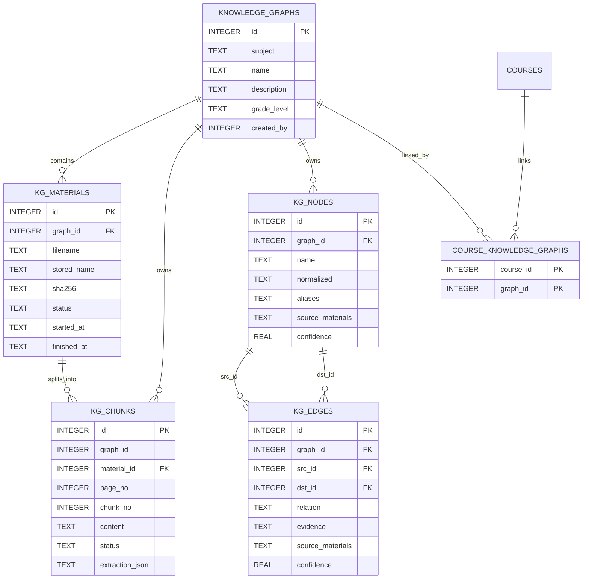
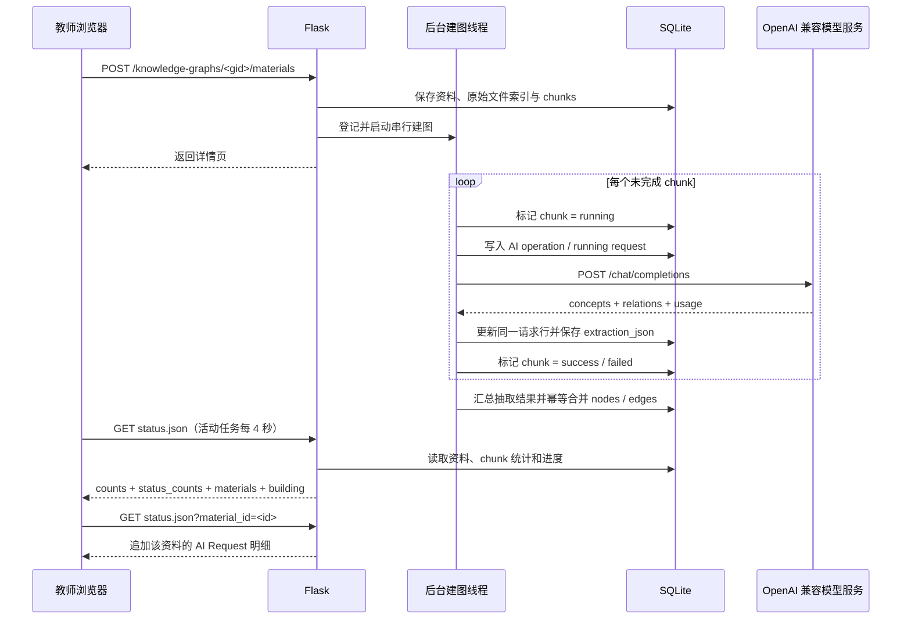

# 学科知识图谱模块：形成依据、组织形式与接口

本文说明 GradeLogy 当前知识图谱模块的实际实现，重点回答三个问题：

1. 图谱依据什么形成，模型在其中做什么；
2. 资料、文本块、概念、关系和课程关联在系统内如何组织；
3. 模块目前提供哪些 Web、JSON 和内部 Python 接口。

> 当前实现是 **Flask 单体应用内的轻量图谱模块**，底层使用 SQLite 邻接表，不是独立的 Neo4j 服务，也没有独立的公开图查询 API。

## 1. 模块定位

知识图谱用于把教材、考纲、讲义等资料沉淀为统一的学科概念及其关系，为讲评课诊断、跨讲次薄弱点分析和前置知识追问提供结构化参照。

当前版本已经完成：

- PDF、Markdown、TXT 资料上传与自动建图；
- 多资料串行处理、增量合并、失败恢复和重启续建；
- 概念节点、三类关系、资料出处和置信度存储；
- 前置关系分层 SVG、概念上下游邻域和资料管理；
- 一个课程关联一个或多个图谱；
- 建图进度、处理时间、AI Request 明细和剩余时间粗估。

当前版本**不会在每次批阅时自动把整张图谱注入模型**。图谱首先是独立的知识底座和可视化模块；课程关联已经可用，但与横向、纵向根因分析的进一步自动联动不属于本模块当前接口范围。

## 2. 图谱形成的依据

### 2.1 第一依据是教师上传的资料

图谱不是让模型自由生成一套“它认为正确”的学科体系，而是以教师上传的资料为主要证据来源。系统提示词明确要求：

- 只抽取资料中明确出现的概念、定理、方法、公式或典型迷思概念；
- 不凭空补充资料之外的内容；
- 关系必须带资料原句或关键短语作为 `evidence`；
- 信息不足时宁缺毋滥；
- 每条抽取结果带 `0~1` 的模型置信度。

因此，资料质量、PDF 文字层质量和模型抽取质量共同决定图谱质量。扫描版 PDF 如果没有可抽取的文字层，不能直接用于当前建图流程。

### 2.2 模型负责“抽取”，数据库负责“沉淀”

LLM 每次只处理一个文本块或截断后的子块，输出严格 JSON：

```json
{
  "concepts": [
    {
      "name": "概念名称",
      "category": "模块/主题分类",
      "definition": "一句话定义",
      "aliases": ["同义写法"],
      "confidence": 0.9
    }
  ],
  "relations": [
    {
      "from": "前置或上位概念",
      "to": "后续或下位概念",
      "relation": "prerequisite",
      "evidence": "资料依据",
      "confidence": 0.85
    }
  ]
}
```

模型输出经过 JSON 修复、字段清洗、关系白名单校验和置信度截断后才进入数据库。单批提示词最多要求 25 个概念和 40 条关系，避免无节制扩展。

三类关系的方向定义如下：

| 关系 | 含义 | 方向 |
|---|---|---|
| `prerequisite` | 前置知识 | `from` 是学习 `to` 前必须具备的基础 |
| `contains` | 结构包含 | `from` 是上位概念，`to` 是下位概念 |
| `related` | 并列、互补或经常共同考查 | 不表达学习先后依赖 |

### 2.3 归一化和多资料增量合并形成统一图谱

不同资料可能使用同一概念的不同写法。系统先对概念名及别名执行去空白、去标点、统一大小写的归一化，再按 `(graph_id, normalized)` 合并节点。

合并时会汇总别名、定义、依据、置信度和资料出处。关系按 `(graph_id, src_id, dst_id, relation)` 去重，因此同一关系被多份资料支持时不会生成重复边，而会保留多份资料出处。

这意味着图谱的形成依据不是某一次模型调用，而是：

**上传资料证据 + 分块模型抽取 + 概念归一化 + 多资料增量合并 + 后续持续增强。**

## 3. 从资料到图谱的完整流程


### 3.1 上传与文本分块

| 项目 | 当前规则 |
|---|---|
| 文件格式 | `.pdf`、`.md`、`.markdown`、`.txt` |
| 单份文件上限 | 默认 500MB，可通过 `KG_MAX_UPLOAD_MB` 调整 |
| 去重方式 | 同一图谱内按文件 SHA-256 去重 |
| PDF 处理 | 使用 `pypdfium2` 按页读取文字层 |
| 文本编码 | 依次尝试 UTF-8-SIG、UTF-8、GB18030 |
| 单份资料建图文本上限 | 前 120,000 字 |
| 分块大小 | 每块最多约 3,000 字 |
| 块间重叠 | 200 字，实际步进为 2,800 字 |
| 页边界 | 跨页不合并，保留 `page_no` 便于追溯 |

上传成功后，系统先保存原始文件、资料记录和全部文本块，再启动后台建图。多份资料可以一次上传，也可以在建图过程中继续追加。

### 3.2 串行调用模型

当前每份资料由一个后台线程处理，进程内锁保证同一时刻只建一份资料，降低模型限流和 SQLite 写入冲突的概率。

每个 chunk 独立经历：

`pending → running → success / failed`

模型调用的输出上限为 `32768 tokens`。如果推理模型把 token 用在思考过程并导致正文截断，系统会优先对半拆批；单块正文大于 1,000 字时，会在换行或句号附近继续对半拆分，而不是直接放弃整份资料。

### 3.3 逐块保存，最后统一合图

每个成功 chunk 的概念和关系都会立即保存到 `kg_chunks.extraction_json`。一份资料的全部 chunk 处理完后，系统再统一汇总该资料所有已保存的抽取结果：

1. 先合并全部概念，建立名称和别名到节点 ID 的映射；
2. 再解析跨 chunk 关系，避免前置概念和后续概念位于不同块时丢边；
3. 最后一次性写入节点和边，并更新资料状态。

部分 chunk 失败时，已有成功结果仍可合图；如果最终没有任何概念，资料标记为失败，否则标记为完成并保留“部分片段失败”的提示。

### 3.4 服务重启后的恢复

服务启动时扫描所有“待建图”和“建图中”资料，按资料 ID 重新入队：

- 已有成功 `extraction_json` 的 chunk 不再调用模型；
- `pending`、`running`、`failed` chunk 重新执行；
- 如果中断发生在合图之后，唯一键和出处合并逻辑保证重放不会制造重复节点或边；
- 同一资料通过进程内登记集合防止重复入队。

这套机制是“数据库保存进度 + 内存线程调度”，不是独立的分布式任务队列。

## 4. 系统内的组织形式

### 4.1 总体数据关系



### 4.2 各表的职责

| 表 | 职责 | 关键约束或字段 |
|---|---|---|
| `knowledge_graphs` | 一张独立学科图谱 | 学科、名称、说明、学段、创建者 |
| `kg_materials` | 原始资料及文件级状态 | `UNIQUE(graph_id, sha256)`；保存页数、字数、错误和处理时间 |
| `kg_chunks` | 资料文本块及断点续建状态 | 保存页码、块号、正文、chunk 状态、抽取 JSON、错误和时间 |
| `kg_nodes` | 概念节点 | `UNIQUE(graph_id, normalized)`；保存定义、别名、出处和置信度 |
| `kg_edges` | 有向关系边 | `UNIQUE(graph_id, src_id, dst_id, relation)`；保存依据、出处和置信度 |
| `course_knowledge_graphs` | 课程与图谱多对多关联 | 复合主键 `(course_id, graph_id)` |

`aliases` 使用 JSON 文本保存；`source_materials` 使用带分隔符的资料 ID 列表保存，用于判断一个节点或边由哪些资料共同支撑。

删除资料时，系统只回收“仅由该资料支撑”的节点和边；如果仍有其他资料出处，节点或边会保留。

### 4.3 文件、图数据与审计数据

- 原始资料：`uploads/kg/<graph_id>/`；
- 图、资料、文本块和关联：主 SQLite 数据库；
- 建图任务：`ai_operations.operation_type = 'kg_build'`，通过 `material_id` 关联资料；
- 单次模型尝试：`ai_usage_events`，通过 `chunk_id` 关联文本块；
- 备份迁移：数据库与 `uploads/kg/` 一起进入系统备份范围。

因此，恢复系统时既能恢复图数据，也能恢复形成图谱的原始证据和逐块处理记录。

### 4.4 展示组织

详情页同时使用三种视图：

1. **资料视图**：文件状态、页数、字数、本地处理时间、chunk 统计、ETA 和请求明细；
2. **表格视图**：概念节点与关系边，可折叠；
3. **图形视图**：按前置关系拓扑分层，最多展示关联度最高的 80 个节点；点击概念进入直接前置、直接延伸、包含和相关概念邻域。

## 5. 当前提供的 HTTP 接口

### 5.1 接口性质与权限

这些接口是 GradeLogy 内部 Web 功能的一部分，使用登录会话鉴权，不是带独立 API Token 的公开 REST API。

路径中的 `<oid:...>` 是系统签名后的对象 ID，不应直接替换为未经编码的数据库整数。教师和管理员可查看共享图谱；上传、编辑、删除要求图谱创建者或管理员。课程关联要求课程负责人或管理员。

| 方法 | 路径 | 用途 | 返回 |
|---|---|---|---|
| GET | `/knowledge-graphs` | 图谱列表及资料、节点、边数量 | HTML |
| POST | `/knowledge-graphs/create` | 创建图谱；表单 `subject/name/description/grade_level` | 重定向 |
| GET | `/knowledge-graphs/<oid:gid>` | 图谱详情、资料、表格和分层图 | HTML |
| GET | `/knowledge-graphs/<oid:gid>/concepts/<oid:nid>` | 单个概念上下游邻域 | HTML |
| GET | `/knowledge-graphs/<oid:gid>/status.json` | 建图状态轮询 | JSON |
| POST | `/knowledge-graphs/<oid:gid>/materials` | 上传一份或多份资料；表单字段 `files` | 重定向 |
| POST | `/knowledge-graphs/materials/<oid:mid>/delete` | 删除资料并回收其独有节点和边 | 重定向 |
| POST | `/knowledge-graphs/<oid:gid>/edit` | 修改名称和说明；表单 `name/description` | 重定向 |
| POST | `/knowledge-graphs/<oid:gid>/delete` | 删除整张图谱、关联和原始文件 | 重定向 |
| POST | `/course/<oid:cid>/knowledge-graphs` | 整体替换课程关联；表单 `graph_ids` 可多选 | 重定向 |

### 5.2 建图状态 JSON

请求：

```http
GET /knowledge-graphs/<oid:gid>/status.json
```

只展开某份资料的 AI Request 时：

```http
GET /knowledge-graphs/<oid:gid>/status.json?material_id=42
```

`material_id` 必须属于当前图谱，否则返回 404。未传该参数时不加载请求历史，避免轮询传输不必要的数据。

典型响应结构：

```json
{
  "counts": {"materials": 4, "nodes": 128, "edges": 236, "chunks": 41},
  "status_counts": {"done": 2, "building": 1, "pending": 1, "failed": 0},
  "building": true,
  "materials": [
    {
      "id": 42,
      "label": "处理中",
      "style": "building",
      "icon": "",
      "error": "",
      "page_count": 18,
      "char_count": 32000,
      "created_at_local": "2026-11-16 08:30",
      "started_at_local": "2026-11-16 08:31",
      "finished_at_local": "",
      "elapsed_text": "3 分 20 秒",
      "chunks": {"total": 12, "pending": 3, "running": 1, "success": 8, "failed": 0},
      "eta_s": 125,
      "eta_text": "2 分 5 秒"
    }
  ],
  "request_material_id": 42,
  "requests": [
    {
      "operation_id": 91,
      "chunk_no": 4,
      "attempt": 1,
      "status": "success",
      "started_at": "2026-11-16 08:33",
      "elapsed_s": 25.1,
      "elapsed_text": "25 秒",
      "prompt_tokens": 3200,
      "completion_tokens": 1100,
      "total_tokens": 4300,
      "finish_reason": "stop",
      "error": ""
    }
  ]
}
```

ETA 取本资料最近 5 个成功 chunk 的实际总耗时中位数，估算待处理块和当前运行块的剩余时间，因此只是“粗估”，不是分布式调度系统的精确承诺。

### 5.3 页面轮询与请求时序



### 5.4 对外模型接口

建图模块本身不监听独立端口。它向外调用教师 AI 配置中的 OpenAI 兼容端点：

```http
POST {api_url}/chat/completions
Authorization: Bearer <api_key>
Content-Type: application/json
```

每个 HTTP 尝试都会记录模型、attempt、状态、耗时、token、finish reason 和错误。管理员 AI 日志与教师端请求明细复用这些记录，不维护两套统计口径。

## 6. 主要内部 Python 接口

| 位置 | 函数 | 职责 |
|---|---|---|
| `utilities/kg_text.py` | `extract_pages(path)` | PDF 按页或文本整体抽取 |
| `utilities/kg_text.py` | `chunk_pages(pages)` | 清洗并按约 3000 字分块 |
| `utilities/kg_text.py` | `normalize_concept(name)` | 概念名及别名归一化 |
| `utilities/knowledge_graph.py` | `analyze_batch(...)` | 调用 LLM 并清洗抽取 JSON |
| `utilities/knowledge_graph.py` | `extract_material(...)` | 资料解析、截断和 chunk 持久化 |
| `utilities/knowledge_graph.py` | `build_material(...)` | 逐块续建、保存结果并统一合图 |
| `utilities/knowledge_graph.py` | `merge_extraction(...)` | 节点、别名、关系和出处增量合并 |
| `utilities/knowledge_graph.py` | `delete_material(...)` | 删除资料并回收独有图元素 |
| `utilities/knowledge_graph.py` | `layered_graph(...)` | 生成前置关系分层图数据 |
| `utilities/knowledge_graph.py` | `concept_neighbors(...)` | 查询概念直接上下游邻域 |
| `app.py` | `start_kg_recovery()` | 启动时恢复待建图和建图中资料 |

## 7. 当前边界

1. **单机单进程调度**：串行锁和防重集合都在进程内，不能直接当作多 worker 或多实例分布式队列使用。
2. **轻量邻接表**：适合当前直接上下游、出处和分层查询；不提供 Cypher、Gremlin 或复杂图算法。
3. **没有公开图查询 API**：当前节点和边通过 HTML 页面展示，JSON 接口只服务建图状态与请求明细。
4. **抽取结果需要教学复核**：置信度来自模型自评，不等同于经过教师审核的正确率。
5. **归一化不是完整本体推理**：当前主要解决同名和别名合并，不自动证明两个不同概念在语义上完全等价。
6. **ETA 是经验估算**：模型限流、重试、推理长度和网络状况都可能使实际时间变化。

## 8. 实现与验证索引

- 建图提示词、抽取、合并、删除和图查询：[utilities/knowledge_graph.py](../utilities/knowledge_graph.py)
- 文本抽取、分块和概念归一化：[utilities/kg_text.py](../utilities/kg_text.py)
- Web 路由、后台队列、启动恢复、状态 JSON：[app.py](../app.py)
- SQLite 表结构与启动中断处理：[db.py](../db.py)
- OpenAI 兼容调用、重试和请求事件：[utilities/llm.py](../utilities/llm.py)
- AI operation、usage、token 和费用记录：[ai_usage.py](../ai_usage.py)
- 教师端页面、分层 SVG 和轮询：[templates/knowledge_graph.html](../templates/knowledge_graph.html)
- 概念邻域页面：[templates/knowledge_graph_concept.html](../templates/knowledge_graph_concept.html)
- 单元与路由测试：[tests/test_knowledge_graph.py](../tests/test_knowledge_graph.py)
- 面向教师的使用说明：[docs/teacher.md](teacher.md)
