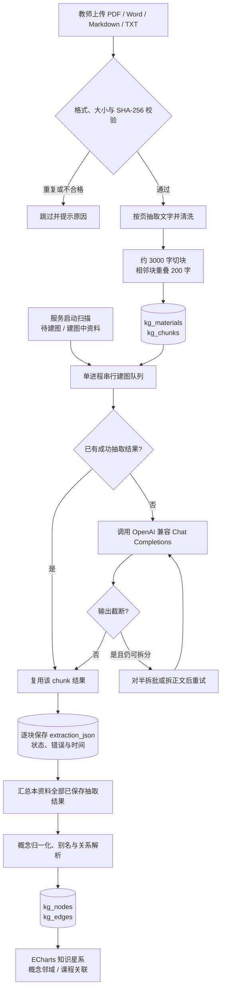
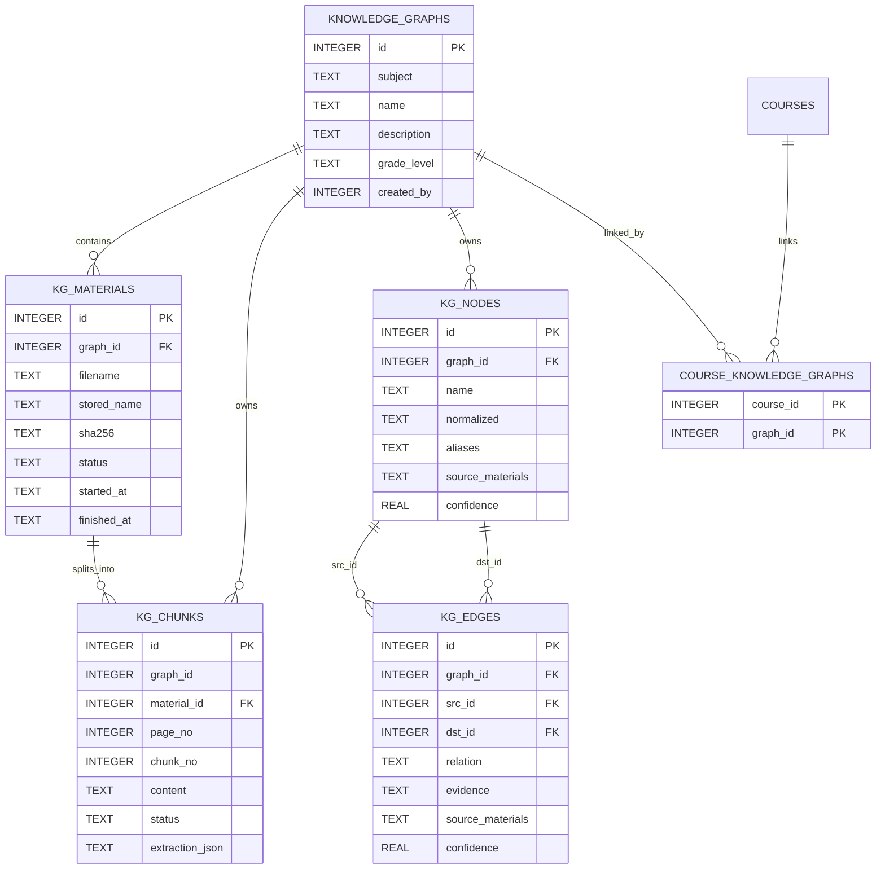
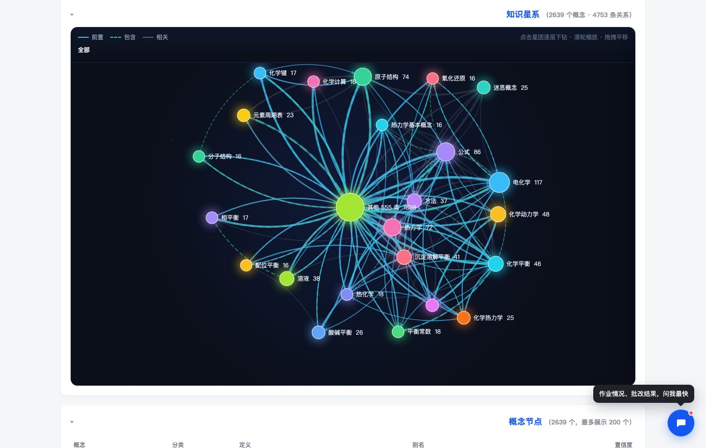
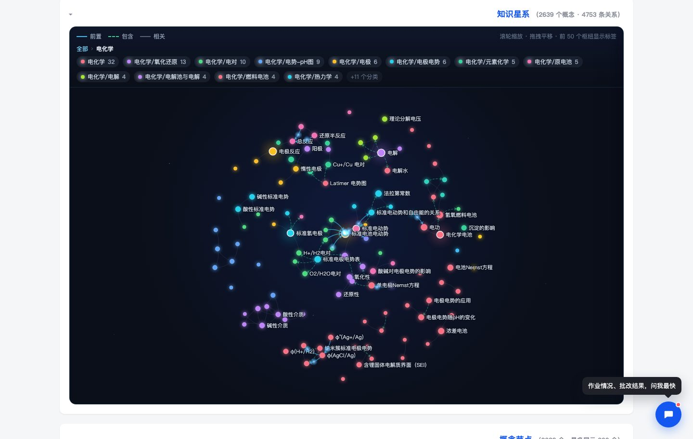
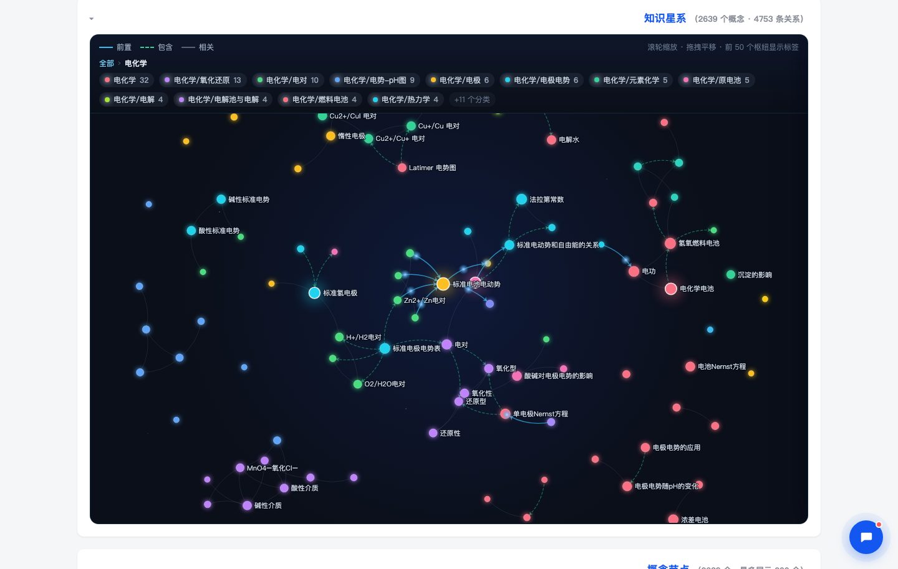
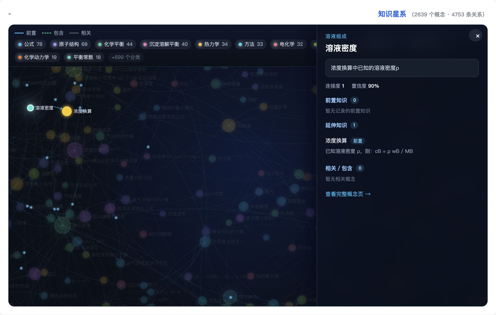
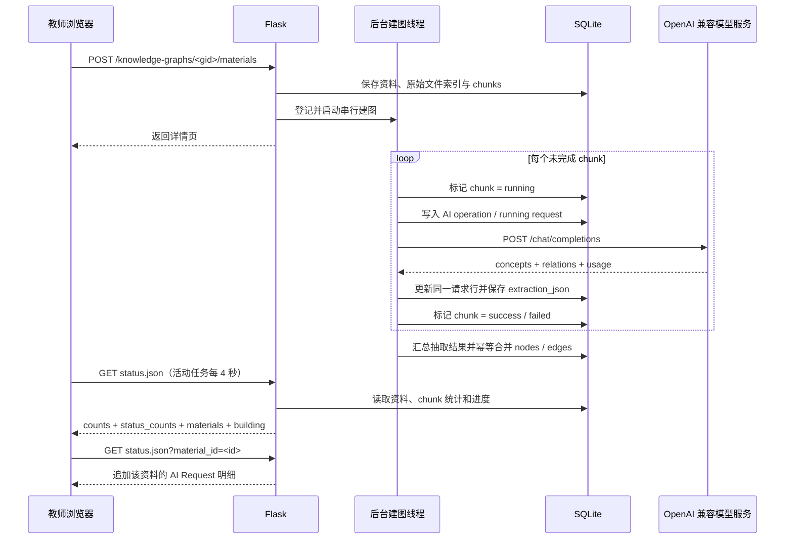

# 学科知识图谱模块：形成依据、组织形式与接口

本文说明 GradeLogy 当前知识图谱模块的实际实现，重点回答三个问题：

1. 图谱依据什么形成，模型在其中做什么；
2. 资料、文本块、概念、关系和课程关联在系统内如何组织；
3. 模块目前提供哪些 Web、JSON 和内部 Python 接口。

> 当前实现是 **Flask 单体应用内的轻量图谱模块**，底层使用 SQLite 邻接表，不是独立的 Neo4j 服务。图谱数据通过登录鉴权的内部 JSON 接口下发给前端，不提供带独立 Token 的公开 REST API。

图谱列表、概念与关系对已登录教师开放浏览；所有教师也可将任意系统图谱关联到自己可访问的课程。权限受 `TEMPORARY_GLOBAL_TEACHER_ACCESS` 影响：**当前默认 `1`** 时，所有老师对所有图谱拥有编辑权限，也能下载资料；设为 `0` 后恢复图谱协作角色限制，源资料仅对创建者、获授权 `use/edit/manage` 成员及管理员开放。课程范围同时按该开关控制。知道文件地址本身不授予权限。

体检和分类操作应用前保存快照，并记录应用后的图谱指纹。只有节点、关系、资料和文本块未发生后续变化时，才能回滚；否则保留当前成果。旧版本快照没有校验信息，不能直接回滚，可使用完整备份或手工调整。

## 1. 模块定位

知识图谱用于把教材、考纲、讲义等资料沉淀为统一的学科概念及其关系，为讲评课诊断、跨讲次薄弱点分析和前置知识追问提供结构化参照。

当前版本**不会在每次批阅时自动把整张图谱注入模型**。课程标签可匹配图谱节点及前置关系，辅助报告、讲次、横向和纵向分析；诊断结论仍需教师判断，复习路径与反馈闭环待完善。

### 1.1 为什么需要知识图谱（价值）

| 价值 | 说明 |
| --- | --- |
| 从"错题"到"错因" | 错题标签定位到知识点后，沿 `prerequisite` 反向追溯前置概念缺口，避免只在表面知识点上反复讲评。 |
| 教学决策 | 按讲次、班级统计概念命中与前置缺口，帮助老师决定讲评优先级和复习顺序。 |
| 学科结构沉淀 | 把教材、考纲、讲义中的概念与关系沉淀为可复用的学科资产，新老师接班不必从零梳理。 |
| AI 可解释 | 节点与关系保留来源资料和证据，AI 的讲解、组卷和答疑可以引用具体依据，而不是凭空生成。 |
| 多人共建 | 所有教师可浏览与关联图谱；在正常权限模式下由创建者/管理员和获授权成员按管理、编辑角色维护。临时全局教师访问开启时，所有老师均获得图谱编辑权限，部署者应明确评估。 |

### 1.2 当前实现进度

| 能力 | 状态 | 说明 |
| --- | --- | --- |
| 资料上传、解析、分块、概念与关系抽取 | 已完成 | PDF/Word/Markdown/TXT；后台建图，支持多文件、失败重试和重启续建。 |
| 增量建图防环 | 已完成 | 写入 `prerequisite` 前用递归 CTE 检查可达性，会成环的关系直接跳过并计数提示。 |
| 存量成环报告 | 已完成 | 对前置子图做强连通分量分析，在详情页列出环上概念和置信度最低、建议优先处理的关系。 |
| 关系维护 | 已完成 | 关系边支持删除与反向；反向仅限 `prerequisite`，先排除原边做防环校验，重复反向边自动合并。 |
| AI 图谱体检 | 已完成 | LLM 只输出结构化建议（合并节点/反向/删除/下线），服务端校验 ID、合并冲突与成环风险后生成预览；用户确认后应用，应用前保存快照，可回滚。 |
| AI 智能去重 | 已完成 | 三路召回疑似重复概念（别名/名称归一冲突、跨分类共享邻居、同分类 token 重叠），候选组按 `KG_DEDUP_CONCURRENCY` 并发送 LLM 判定；逐组进度实时可见，失败/重启后可从未完成候选组断点续跑（已完成组不重复调用模型）；按簇可视化预览，教师逐簇确认后应用，复用体检的校验/快照/回滚。 |
| 资料归档减容 | 已完成 | 把已建图资料的源文件移出 `uploads/` 到独立归档目录，仅保留建图历史（元数据、文本块、节点、关系、体检记录）；归档文件不进系统备份，可随时还原。 |
| 协作权限 | 已完成 | 创建者/管理员拥有管理权限；获授权成员可设为管理、编辑或使用角色。成员管理只对管理角色开放；教师只读浏览和课程关联不依赖成员记录。`TEMPORARY_GLOBAL_TEACHER_ACCESS=1` 时所有老师临时获得编辑权限，但不因此获得管理角色。 |
| 图谱运营指标 | 已完成 | 详情页展示语料文件与各数据表的空间占用、累计构建用时、Token 和涉及模型。 |
| 课程关联 | 已完成 | 所有教师可把任意系统图谱引入自己可访问的课程；关联用于讲次及学生分析，尚无独立的概念覆盖热力图。 |
| 根因联动 | 部分完成 | 已按课程关联图谱匹配标签与前置关系，辅助分析；教师确认与复习路径闭环待完善。 |

### 1.3 Roadmap

截至 2026-11-24 的代码状态：P1–P5 均有部分基础，不代表整阶段完成。P1 已有标签匹配、报告诊断和图谱前置链辅助；P2 已有需教师确认的体检/分类建议；P3 已有错题本、薄弱点及复习状态；P4 已有增量合并、文本块续建及 JSON 迁移；P5 有部分操作记录。下表只列仍未闭环的目标，不代表当前已支持的用户操作前置条件。界面历史方案见 [设计评估](ui-design.md)。

| 阶段 | 目标 |
| --- | --- |
| P1 根因联动 | 错题标签 → 图谱节点 → 前置缺口链路自动生成，讲评页直接给出"建议先补哪个概念"，并允许老师确认/否决。 |
| P2 质量治理自动化 | 在体检建议基础上，对高置信的同名合并、孤立节点下线提供"一键应用"；补充置信度校准、重复证据检测与体检定时任务。 |
| P3 教学闭环 | 学生端按前置关系生成复习路径；班级/讲次概念覆盖热力图；图谱缺口与错题分布联动。 |
| P4 工程能力 | 建图任务多 worker 队列与限流；按资料增量重建；GraphML 导入导出（JSON 迁移包已支持）；图谱版本快照与差异对比。 |
| P5 治理与审计 | 全量操作审计、快照保留策略、跨学科图谱复用（资料归档减容已落地）。 |

## 2. 图谱形成的依据

### 2.1 第一依据是教师上传的资料

图谱不是让模型自由生成一套“它认为正确”的学科体系，而是以教师上传的资料为主要证据来源。系统提示词明确要求：

- 只抽取资料中明确出现的概念、定理、方法、公式或典型迷思概念；
- 不凭空补充资料之外的内容；
- 关系必须带资料原句或关键短语作为 `evidence`；
- 信息不足时宁缺毋滥；
- 每条抽取结果带 `0~1` 的模型置信度。

因此，资料质量、PDF 文字层质量和模型抽取质量共同决定图谱质量。扫描版 PDF 如果没有可抽取的文字层，不能直接用于当前建图流程。

### 2.2 模型负责“抽取”，数据库负责“沉淀”

LLM 每次只处理一个文本块或截断后的子块，输出严格 JSON：

```json
{
  "concepts": [
    {
      "name": "概念名称",
      "category": "模块/主题分类",
      "definition": "一句话定义",
      "aliases": ["同义写法"],
      "confidence": 0.9
    }
  ],
  "relations": [
    {
      "from": "前置或上位概念",
      "to": "后续或下位概念",
      "relation": "prerequisite",
      "evidence": "资料依据",
      "confidence": 0.85
    }
  ]
}
```

模型输出经过 JSON 修复、字段清洗、关系白名单校验和置信度截断后才进入数据库。单批提示词最多要求 25 个概念和 40 条关系，避免无节制扩展。

三类关系的方向定义如下：

| 关系 | 含义 | 方向 |
|---|---|---|
| `prerequisite` | 前置知识 | `from` 是学习 `to` 前必须具备的基础 |
| `contains` | 结构包含 | `from` 是上位概念，`to` 是下位概念 |
| `related` | 并列、互补或经常共同考查 | 不表达学习先后依赖 |

### 2.3 归一化和多资料增量合并形成统一图谱

不同资料可能使用同一概念的不同写法。系统先对概念名及别名执行去空白、去标点、统一大小写的归一化，再按 `(graph_id, normalized)` 合并节点。

合并时会汇总别名、定义、依据、置信度和资料出处。关系按 `(graph_id, src_id, dst_id, relation)` 去重，因此同一关系被多份资料支持时不会生成重复边，而会保留多份资料出处。

这意味着图谱的形成依据不是某一次模型调用，而是：

**上传资料证据 + 分块模型抽取 + 概念归一化 + 多资料增量合并 + 后续持续增强。**

## 3. 从资料到图谱的完整流程



### 3.1 上传与文本分块

| 项目 | 当前规则 |
|---|---|
| 文件格式 | `.pdf`、`.doc`、`.docx`、`.md`、`.markdown`、`.txt` |
| 单份文件上限 | 默认 500MB，可通过 `KG_MAX_UPLOAD_MB` 调整 |
| 去重方式 | 同一图谱内按文件 SHA-256 去重 |
| PDF 处理 | 使用 `pypdfium2` 按页读取文字层 |
| Word 处理 | DOCX 读取正文 XML；DOC 解析 Word 97-2003 二进制正文，加密文档需先解除密码 |
| 文本编码 | 依次尝试 UTF-8-SIG、UTF-8、GB18030 |
| 单份资料建图文本上限 | 前 120,000 字 |
| 分块大小 | 每块最多约 3,000 字 |
| 块间重叠 | 200 字，实际步进为 2,800 字 |
| 页边界 | 跨页不合并，保留 `page_no` 便于追溯 |

上传成功后，系统先保存原始文件、资料记录和全部文本块，再启动后台建图。多份资料可以一次上传，也可以在建图过程中继续追加。

### 3.2 串行调用模型

当前每份资料由一个后台线程处理，进程内锁保证同一时刻只建一份资料，降低模型限流和 SQLite 写入冲突的概率。

每个 chunk 独立经历：

`pending → running → success / failed`

模型调用的输出上限为 `32768 tokens`。如果推理模型把 token 用在思考过程并导致正文截断，系统会优先对半拆批；单块正文大于 1,000 字时，会在换行或句号附近继续对半拆分，而不是直接放弃整份资料。

### 3.3 逐块保存，最后统一合图

每个成功 chunk 的概念和关系都会立即保存到 `kg_chunks.extraction_json`。一份资料的全部 chunk 处理完后，系统再统一汇总该资料所有已保存的抽取结果：

1. 先合并全部概念，建立名称和别名到节点 ID 的映射；
2. 再解析跨 chunk 关系，避免前置概念和后续概念位于不同块时丢边；
3. 最后一次性写入节点和边，并更新资料状态。

部分 chunk 失败时，已有成功结果仍可合图；如果最终没有任何概念，资料标记为失败，否则标记为完成并保留“部分片段失败”的提示。

### 3.4 服务重启后的恢复

服务启动时扫描所有“待建图”和“建图中”资料，按资料 ID 重新入队：

- 已有成功 `extraction_json` 的 chunk 不再调用模型；
- `pending`、`running`、`failed` chunk 重新执行；
- 如果中断发生在合图之后，唯一键和出处合并逻辑保证重放不会制造重复节点或边；
- 同一资料通过进程内登记集合防止重复入队。

这套机制是“数据库保存进度 + 内存线程调度”，不是独立的分布式任务队列。

## 4. 系统内的组织形式

### 4.1 总体数据关系



### 4.2 各表的职责

| 表 | 职责 | 关键约束或字段 |
|---|---|---|
| `knowledge_graphs` | 一张独立学科图谱 | 学科、名称、说明、学段、创建者 |
| `kg_materials` | 原始资料及文件级状态 | `UNIQUE(graph_id, sha256)`；保存页数、字数、错误和处理时间；`archived_at` 非空表示源文件已归档（移出 uploads 但建图历史保留） |
| `kg_chunks` | 资料文本块及断点续建状态 | 保存页码、块号、正文、chunk 状态、抽取 JSON、错误和时间 |
| `kg_nodes` | 概念节点 | `UNIQUE(graph_id, normalized)`；保存定义、别名、出处和置信度 |
| `kg_edges` | 有向关系边 | `UNIQUE(graph_id, src_id, dst_id, relation)`；保存依据、出处和置信度 |
| `kg_audits` | 图谱体检记录 | 保存模型、建议 JSON、未通过校验的原因、应用前快照、`operation_id` 与状态 |
| `kg_category_maps` | 分类重构记录 | 保存模型生成的分类映射、校验未通过项、应用前快照、`operation_id` 与状态 |
| `kg_dedup_runs` | 智能去重记录 | 保存候选组、模型输出、校验通过/拒绝的合并簇、应用前快照、`operation_id` 与状态 |
| `kg_members` | 图谱协作成员 | 复合主键 `(graph_id, user_id)`；`role` 为 `manage/edit/use` |
| `course_knowledge_graphs` | 课程与图谱多对多关联 | 复合主键 `(course_id, graph_id)` |

`aliases` 使用 JSON 文本保存；`source_materials` 使用带分隔符的资料 ID 列表保存，用于判断一个节点或边由哪些资料共同支撑。

删除资料时，系统只回收“仅由该资料支撑”的节点和边；如果仍有其他资料出处，节点或边会保留。

### 4.3 文件、图数据与审计数据

- 原始资料：`uploads/kg/<graph_id>/`；
- 图、资料、文本块和关联：主 SQLite 数据库；
- 建图任务：`ai_operations.operation_type = 'kg_build'`，通过 `material_id` 关联资料；
- 单次模型尝试：`ai_usage_events`，通过 `chunk_id` 关联文本块；
- 图谱体检：`ai_operations.operation_type = 'kg_audit'`，`kg_audits.operation_id` 记录对应调用，用于把 token 归属到图谱；
- 备份迁移：数据库与 `uploads/kg/` 一起进入系统备份范围；已归档资料的源文件位于独立归档目录（默认 `data/archives/kg/`），不进入备份，以减少备份体积。

详情页的「存储明细」把空间拆成两部分：语料文件大小，以及 `knowledge_graphs/kg_materials/kg_chunks/kg_nodes/kg_edges/kg_audits/kg_members` 各表的估算占用。由于运行环境的 SQLite 未启用 `dbstat`，表占用按行文本长度加约 15% 行头与索引开销估算，并在页面上注明口径。资料区另显示已归档数量与已节省空间，已归档资料的源文件不计入语料文件大小。

因此，恢复系统时既能恢复图数据，也能恢复形成图谱的原始证据和逐块处理记录。

### 4.4 展示组织

详情页同时使用四种视图：

1. **资料视图**：文件状态、页数、字数、本地处理时间、chunk 统计、ETA 和请求明细；
2. **表格视图**：概念节点与关系边，可折叠；关系边支持反向与删除；
3. **图形视图（知识星系）**：ECharts 5 力导向图，默认只画按 `category` 路径聚合出的星团（每层最多 24 个），点击星团逐层下钻，进入某模块且概念数不超过 150 时才渲染真实节点与关系；节点半径随连接度 `degree` 变化，只默认显示连接度前 50 的枢纽标签，滚轮放大后按视野动态补充次级标签；悬停/点击触发 `emphasis.focus: 'adjacency'` 邻接聚光，点击概念从右侧抽屉展示定义、证据出处和上下游跳转；
4. **治理视图**：成环告警、AI 体检建议预览、协作成员管理、空间/耗时/Token/模型指标与存储明细。

### 4.5 知识星系界面（生产图谱实测）

以下截图来自从生产环境导出的化学知识图谱迁移包（`scope=graph`）重新导入后的实例，包内声明 2639 个概念、4753 条关系；导入后数据库节点与边数量一致，`graph.json` 返回 711 个分类，最大连接度为 43（速率常数），浏览器控制台无脚本报错。

**星团概览**：首屏不再渲染 2000+ 节点，而是把节点按 `category` 的 `/` 层级聚合为星团（每层最多 24 个，超出部分折叠为「其他 N 类」继续下钻），星团大小与其概念数成正比、边按星团间关系聚合。首屏元素数从 2639 个节点降到 24 个星团，力导向布局瞬间稳定：



**逐层下钻**：点击星团进入下一层，面包屑记录路径（如「全部 › 电化学」）。某个分支的概念数不超过 150 时改为渲染真实概念与关系，此时恢复完整的力导向、粒子与标签 LOD：



**滚轮放大**：`graphRoam` 触发 LOD，按视野补充次级节点标签，并按连接度分层限制数量避免重叠：



**节点抽屉**：点击概念后邻接节点高亮、无关节点暗化，右侧滑出半透明抽屉，展示定义、连接度、置信度、前置/延伸/相关概念及其证据出处，并提供「查看完整概念页」入口：



## 5. 当前提供的 HTTP 接口

### 5.1 接口性质与权限

这些接口是 GradeLogy 内部 Web 功能的一部分，使用登录会话鉴权，不是带独立 API Token 的公开 REST API。

路径中的 `<oid:...>` 是系统签名后的对象 ID，不应直接替换为未经编码的数据库整数。所有教师可浏览图谱并将其关联到可访问的课程；写操作按协作角色控制，但临时全局教师访问开关会授予所有老师 `edit` 权限：

| 角色 | 能力 |
| --- | --- |
| `manage` | 改名、删除图谱、分配/移除成员；创建者和管理员自动拥有 |
| `edit` | 上传/重试/删除资料、下载资料、归档/还原资料、反向/删除关系、执行体检并应用建议、执行分类重构并应用建议、执行智能去重并应用建议 |
| `use` | 协作成员角色；可下载图谱源资料，但关联课程不再要求 `use` 角色 |
| 其他教师（只读） | 仅在 `TEMPORARY_GLOBAL_TEACHER_ACCESS=0` 时适用：查看图谱、概念邻域与运营指标，可将图谱关联到自己有权限的课程，但不能下载源资料 |

`TEMPORARY_GLOBAL_TEACHER_ACCESS` 默认是 `1`：普通教师实际按 `edit` 角色授权（但仍非 `manage`）；设为 `0` 才按上表的创建者和协作成员角色进行隔离。该开关也影响教师访问课程的范围，部署环境应在开放真实学生数据前显式检查。

课程关联要求当前账号对目标课程有权限（创建者或共同管理老师）；成员管理只对 `manage` 开放。

| 方法 | 路径 | 用途 | 返回 |
|---|---|---|---|
| GET | `/knowledge-graphs` | 图谱列表及资料、节点、边数量 | HTML |
| POST | `/knowledge-graphs/create` | 创建图谱；表单 `subject/name/description/grade_level` | 重定向 |
| GET | `/knowledge-graphs/<oid:gid>` | 图谱详情、资料、表格和知识星系 | HTML |
| GET | `/knowledge-graphs/<oid:gid>/concepts/<oid:nid>` | 单个概念上下游邻域 | HTML |
| GET | `/knowledge-graphs/<oid:gid>/graph.json` | 全量节点（含 `degree`）、关系、分类与统计，供知识星系一次性加载 | JSON |
| GET | `/knowledge-graphs/<oid:gid>/neighbors.json?node_id=` | 概念直接前置/延伸/相关邻域，附概念页带签名的跳转 `url` | JSON |
| GET | `/knowledge-graphs/<oid:gid>/scope.json?ids=` | 查询当前层级的概念与内部关系，最多 200 个节点、400 条边，供表格联动 | JSON |
| GET | `/knowledge-graphs/<oid:gid>/status.json` | 建图状态轮询 | JSON |
| GET | `/knowledge-graphs/<oid:gid>/export` | 导出指定图谱的迁移包；`scope=graph` 时仅导出知识图谱；包内不保留图谱名称 | ZIP 下载 |
| POST | `/knowledge-graphs/import` | 导入迁移包并新建图谱；表单 `package/name`，名称由导入者指定 | 重定向 |
| POST | `/knowledge-graphs/<oid:gid>/materials` | 上传一份或多份资料；表单字段 `files` | 重定向 |
| POST | `/knowledge-graphs/materials/<oid:mid>/retry` | 重试失败资料的建图；复用成功文本块，仅重新处理未完成块 | 重定向 |
| POST | `/knowledge-graphs/materials/<oid:mid>/delete` | 删除资料并回收其独有节点和边 | 重定向 |
| POST | `/knowledge-graphs/materials/<oid:mid>/archive` | 把已建图资料的源文件移入归档目录，保留建图历史 | 重定向 |
| POST | `/knowledge-graphs/materials/<oid:mid>/restore` | 把已归档资料的源文件还原回 uploads | 重定向 |
| POST | `/knowledge-graphs/<oid:gid>/materials/bulk-archive` | 批量归档资料；表单 `material_ids` 多选，整体事务一致 | 重定向 |
| POST | `/knowledge-graphs/<oid:gid>/materials/bulk-restore` | 批量还原已归档资料；表单 `material_ids` 多选 | 重定向 |
| POST | `/knowledge-graphs/<oid:gid>/edit` | 修改名称和说明；表单 `name/description` | 重定向 |
| POST | `/knowledge-graphs/<oid:gid>/delete` | 删除整张图谱、关联和原始文件 | 重定向 |
| POST | `/knowledge-graphs/<oid:gid>/edges/<oid:eid>/reverse` | 反向前置关系；会成环则拒绝，重复边自动合并 | 重定向 |
| POST | `/knowledge-graphs/<oid:gid>/edges/<oid:eid>/delete` | 删除一条关系边 | 重定向 |
| POST | `/knowledge-graphs/<oid:gid>/audit` | 运行 AI 图谱体检并保存建议 | 重定向 |
| POST | `/knowledge-graphs/<oid:gid>/audit/<oid:aid>/apply` | 应用体检建议并保存应用前快照 | 重定向 |
| POST | `/knowledge-graphs/<oid:gid>/audit/<oid:aid>/rollback` | 从快照回滚已应用的建议 | 重定向 |
| POST | `/knowledge-graphs/<oid:gid>/audit/<oid:aid>/discard` | 忽略一次体检结果 | 重定向 |
| POST | `/knowledge-graphs/<oid:gid>/dedup` | 异步运行智能去重并保存合并簇建议；候选组并发判定并逐组记录进度 | 重定向 |
| POST | `/knowledge-graphs/<oid:gid>/dedup/<oid:did>/resume` | 从断点继续未完成的候选组，已完成组复用结果 | 重定向 |
| POST | `/knowledge-graphs/<oid:gid>/dedup/<oid:did>/apply` | 应用所选去重合并簇并保存应用前快照；表单 `keep_ids` 为保留的簇 | 重定向 |
| POST | `/knowledge-graphs/<oid:gid>/dedup/<oid:did>/rollback` | 从快照回滚最近一次已应用的去重 | 重定向 |
| POST | `/knowledge-graphs/<oid:gid>/dedup/<oid:did>/discard` | 忽略一次去重结果 | 重定向 |
| POST | `/knowledge-graphs/<oid:gid>/categories/analyze` | 异步分析并预览分类重构建议 | 重定向 |
| POST | `/knowledge-graphs/<oid:gid>/categories/<oid:mid>/apply` | 应用所选分类映射；表单 `selected` 为所选映射索引 | 重定向 |
| POST | `/knowledge-graphs/<oid:gid>/categories/<oid:mid>/rollback` | 从应用前快照回滚分类重构 | 重定向 |
| POST | `/knowledge-graphs/<oid:gid>/categories/<oid:mid>/discard` | 忽略一次待处理的分类重构建议 | 重定向 |
| POST | `/knowledge-graphs/<oid:gid>/members` | 新增或调整协作老师；表单 `user_id/role` | 重定向 |
| POST | `/knowledge-graphs/<oid:gid>/members/<oid:uid>/remove` | 移除协作老师 | 重定向 |
| POST | `/course/<oid:cid>/knowledge-graphs` | 整体替换课程关联；表单 `graph_ids` 可多选 | 重定向 |

迁移包（`format=gradelogy-kg`, `version=2`）除 `data.json`、`manifest.json` 和 `files/` 下的原始资料外，还会写入：

- `metadata.json`：结构化元数据，包含学科/学段、各表数量、关系类型及方向、字段释义、出处约定和导入建议，且有意省略原图谱名称；
- `README.md`：面向人与大语言模型的自然语言说明，解释包结构、关系语义、关键字段以及重建图谱的最小步骤。

导入仍兼容 `version=1` 的旧包；新包缺少这两个说明文件时也允许导入。

独立图谱迁移包目前不包含分类治理历史 `kg_category_maps`；整站数据库备份包含该表。导入会重映射对象编号，迁移后的历史快照不能直接回滚，应重新生成治理建议。

`scope=graph` 的“仅导出知识图谱”包只包含图谱信息、`kg_nodes` 与 `kg_edges`，
不包含 `files/` 下的原始资料、文本块、体检历史和协作成员，节点/关系上的
`source_materials` 会被清空。该包可正常导入 GradeLogy 或迁移到其他平台，
但只能恢复图谱结构，无法恢复或重建原始资料内容。

### 5.2 建图状态 JSON

请求：

```http
GET /knowledge-graphs/<oid:gid>/status.json
```

只展开某份资料的 AI Request 时：

```http
GET /knowledge-graphs/<oid:gid>/status.json?material_id=42
```

`material_id` 必须属于当前图谱，否则返回 404。未传该参数时不加载请求历史，避免轮询传输不必要的数据。

典型响应结构：

```json
{
  "counts": {"materials": 4, "nodes": 128, "edges": 236, "chunks": 41},
  "status_counts": {"done": 2, "building": 1, "pending": 1, "failed": 0},
  "building": true,
  "materials": [
    {
      "id": 42,
      "label": "处理中",
      "style": "building",
      "icon": "",
      "error": "",
      "page_count": 18,
      "char_count": 32000,
      "created_at_local": "2026-11-16 08:30",
      "started_at_local": "2026-11-16 08:31",
      "finished_at_local": "",
      "elapsed_text": "3 分 20 秒",
      "chunks": {"total": 12, "pending": 3, "running": 1, "success": 8, "failed": 0},
      "eta_s": 125,
      "eta_text": "2 分 5 秒"
    }
  ],
  "request_material_id": 42,
  "requests": [
    {
      "operation_id": 91,
      "chunk_no": 4,
      "attempt": 1,
      "status": "success",
      "started_at": "2026-11-16 08:33",
      "elapsed_s": 25.1,
      "elapsed_text": "25 秒",
      "prompt_tokens": 3200,
      "completion_tokens": 1100,
      "total_tokens": 4300,
      "finish_reason": "stop",
      "error": ""
    }
  ]
}
```

ETA 取本资料最近 5 个成功 chunk 的实际总耗时中位数，估算待处理块和当前运行块的剩余时间，因此只是“粗估”，不是分布式调度系统的精确承诺。

### 5.3 页面轮询与请求时序



### 5.4 对外模型接口

建图模块本身不监听独立端口。它向外调用教师 AI 配置中的 OpenAI 兼容端点：

```http
POST {api_url}/chat/completions
Authorization: Bearer <api_key>
Content-Type: application/json
```

每个 HTTP 尝试都会记录模型、attempt、状态、耗时、token、finish reason 和错误。管理员 AI 日志与教师端请求明细复用这些记录，不维护两套统计口径。

## 6. 主要内部 Python 接口

| 位置 | 函数 | 职责 |
|---|---|---|
| `utilities/kg_text.py` | `extract_pages(path)` | PDF 按页、Word 按分页符或文本整体抽取 |
| `utilities/kg_text.py` | `chunk_pages(pages)` | 清洗并按约 3000 字分块 |
| `utilities/kg_text.py` | `normalize_concept(name)` | 概念名及别名归一化 |
| `utilities/knowledge_graph.py` | `analyze_batch(...)` | 调用 LLM 并清洗抽取 JSON |
| `utilities/knowledge_graph.py` | `extract_material(...)` | 资料解析、截断和 chunk 持久化 |
| `utilities/knowledge_graph.py` | `build_material(...)` | 逐块续建、保存结果并统一合图 |
| `utilities/knowledge_graph.py` | `merge_extraction(...)` | 节点、别名、关系和出处增量合并，前置关系写前防环 |
| `utilities/knowledge_graph.py` | `prerequisite_reachable(...)` | 递归 CTE 判断前置子图可达性 |
| `utilities/knowledge_graph.py` | `prerequisite_cycles(...)` | 强连通分量找出存量前置环 |
| `utilities/knowledge_graph.py` | `delete_material(...)` | 删除资料并回收独有图元素 |
| `utilities/knowledge_graph.py` | `layered_graph(...)` | 生成前置关系分层数据（详情页已改用知识星系，保留供脚本与测试使用） |
| `utilities/knowledge_graph.py` | `graph_payload(...)` | 汇总全量节点、关系、分类与节点连接度 `degree`，供知识星系接口下发 |
| `utilities/knowledge_graph.py` | `concept_neighbors(...)` | 查询概念直接上下游邻域 |
| `utilities/knowledge_graph.py` | `analyze_graph(...)` | 调用模型生成图谱体检建议 |
| `utilities/knowledge_graph.py` | `validate_audit_suggestions(...)` | 校验建议的 ID、合并冲突和成环风险 |
| `utilities/knowledge_graph.py` | `apply_audit(...)` / `restore_snapshot(...)` | 应用建议与快照回滚 |
| `utilities/kg_dedup.py` | `build_dedup_candidates(...)` / `run_dedup(...)` / `run_dedup_run(...)` | 三路召回疑似重复概念，并发分批送 LLM 判定合并簇；持久化逐组状态与进度，支持断点续跑，汇总后复用体检校验 |
| `utilities/kg_archive.py` | `archive_material(...)` / `restore_material_archive(...)` / `bulk_archive_materials(...)` | 资料源文件归档/还原与批量事务，解析归档路径 |
| `app.py` | `start_kg_recovery()` | 启动时恢复待建图和建图中资料 |

## 7. 当前边界

1. **单机单进程调度**：串行锁和防重集合都在进程内，不能直接当作多 worker 或多实例分布式队列使用。
2. **轻量邻接表**：适合当前直接上下游、出处和分层查询；不提供 Cypher、Gremlin 或复杂图算法。
3. **首载仍为全量图**：`graph.json` 一次性下发全部节点与边，没有分页或增量版本；`scope.json` 和 `neighbors.json` 已支持局部表格及概念详情查询。接口均依赖登录权限，不是公开 API。
4. **抽取结果需要教学复核**：置信度来自模型自评，不等同于经过教师审核的正确率。
5. **归一化不是完整本体推理**：当前主要解决同名和别名合并，不自动证明两个不同概念在语义上完全等价。
6. **ETA 是经验估算**：模型限流、重试、推理长度和网络状况都可能使实际时间变化。
7. **表空间是估算值**：环境未启用 SQLite `dbstat`，不读取真实页分配，按行内容长度与固定开销推算。
8. **体检不自动落库**：LLM 建议必须经过服务端校验和人工确认；同名合并、孤立节点下线目前也不自动执行。
9. **根因联动尚未闭环**：相关分析已使用课程图谱的标签匹配和前置关系；不会在每次批阅时注入整张图谱，诊断和复习路径仍需教师判断。
10. **去重不自动合并**：LLM 只给出合并簇建议，必须经服务端校验（ID 归属、冲突、防环）和教师逐簇确认后才应用；应用前保存快照，可回滚。单组模型失败只记录错误、不中断整体。
11. **归档不删建图历史**：归档只移动源文件，`kg_chunks/kg_nodes/kg_edges/kg_materials` 行全部保留；归档文件不进系统备份，可还原。建图中/待建图的资料不允许归档。

## 8. 实现与验证索引

- 建图提示词、抽取、合并、删除和图查询：[utilities/knowledge_graph.py](../utilities/knowledge_graph.py)
- 文本抽取、分块和概念归一化：[utilities/kg_text.py](../utilities/kg_text.py)
- Web 路由、后台队列、启动恢复、状态 JSON：[app.py](../app.py)
- SQLite 表结构与启动中断处理：[db.py](../db.py)
- OpenAI 兼容调用、重试和请求事件：[utilities/llm.py](../utilities/llm.py)
- AI operation、usage、token 和费用记录：[ai_usage.py](../ai_usage.py)
- 教师端页面、知识星系容器与轮询：[templates/knowledge_graph.html](../templates/knowledge_graph.html)
- 知识星系前端渲染（层级聚合与下钻、ECharts 力导向、LOD 标签、抽屉、粒子）：[static/kg_echarts.js](../static/kg_echarts.js)
- 概念邻域页面：[templates/knowledge_graph_concept.html](../templates/knowledge_graph_concept.html)
- 单元与路由测试：[tests/test_knowledge_graph.py](../tests/test_knowledge_graph.py)
- 面向教师的使用说明：[docs/teacher.md](teacher.md)

### 教师浏览分区（2026-11-18）

详情页默认打开浏览：搜索全部概念的名称、分类与别名，结果可直接进入概念页；星团仍按分类逐层下钻。资料、治理、协作与存储独立分区，构建失败和成环保留可见入口。图形库加载失败时保留搜索与服务端概念列表。快速切换概念不会用旧请求覆盖新详情，关闭抽屉后恢复焦点。

搜索复用一次全量图谱数据请求，新增概念页链接；当前仍有全量传输成本。scope/neighbor 的局部请求不等于按需加载整图，后续优化应分别度量传输、布局和详情延迟。
