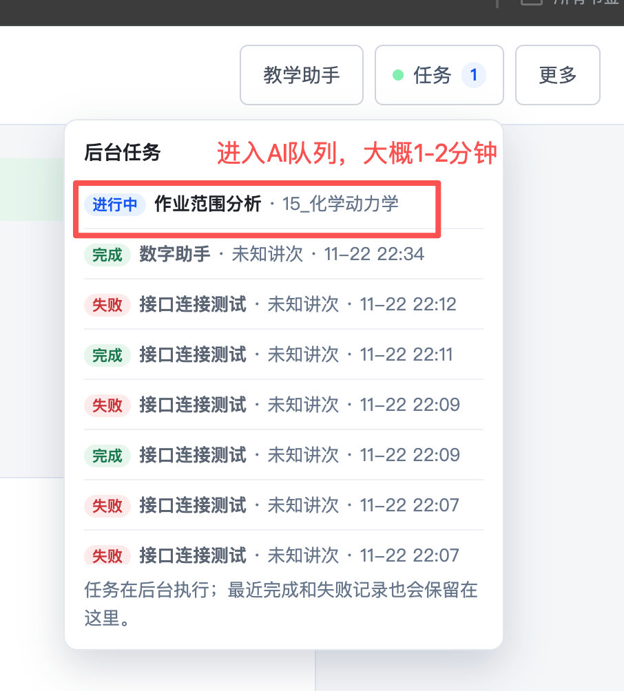
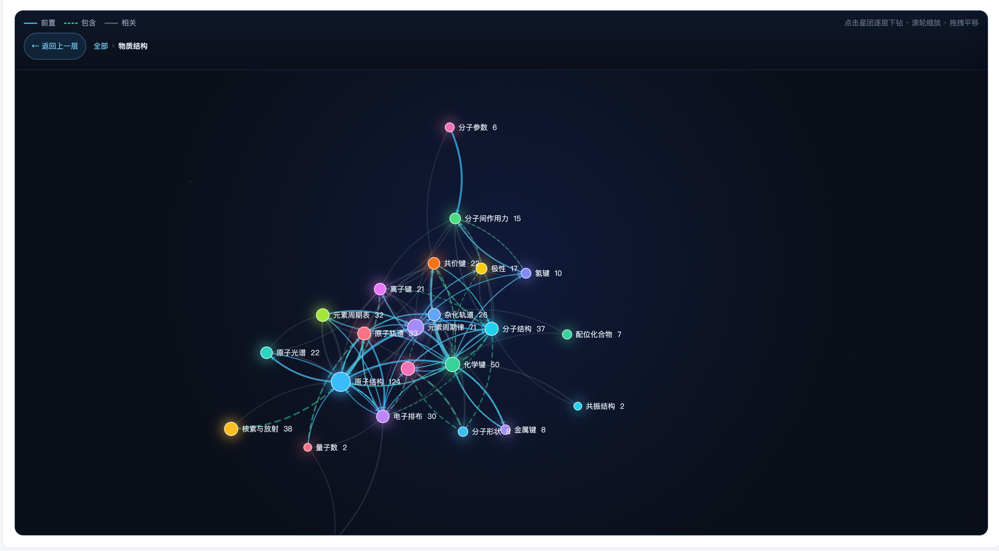
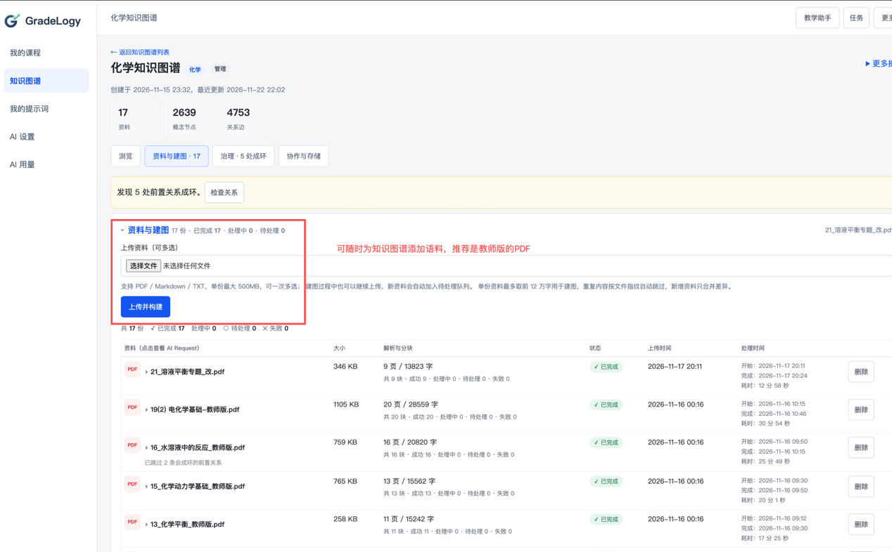
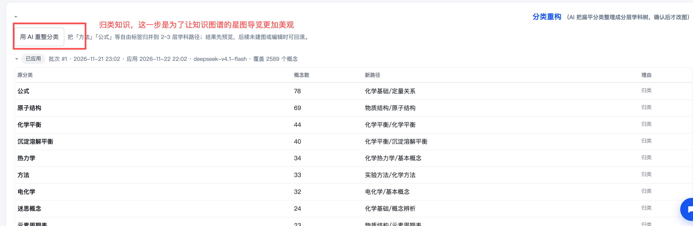

# GradeLogy 新手上手指南

这份指南带你走完一遍完整的作业流程：**准备账号 → 建课 → 准备讲次 → 学生交作业 → 教师批阅与复核 → 发布报告 → 学生复习**。只保留不含学生身份、作答和成绩的界面示例；含个人记录的截图与报告样本不随指南发布。页面细节可能随版本调整，请以当前页面按钮和[教师流程说明](teacher-workflows.md)为准。

> **最快路径**：管理员准备账号 → 教师建课并加入学生 → 上传教师版答案并设置作业范围 → 学生提交 → 教师手动 AI 批阅、逐题复核并发布。知识点标签和知识图谱不是手动批阅的必需条件；标签是自动批阅的额外前置条件，也用于薄弱点和错题分析。

## 1. 开始前：确认账号与角色

GradeLogy 有管理员、教师和学生三种角色。管理员负责创建、批量创建和维护账号；教师管理课程和作业；学生提交作业并查看已发布的结果。首次登录若使用初始密码，系统会要求先修改密码。

管理员也可以从 CSV 批量创建用户；具体导入格式、密码重置和账号启停请参阅[管理员手册](admin.md)。

## 2. 教师：创建课程并加入学生

1. 登录教师账号，进入「我的课程」并选择「新建课程」，填写课程名称和简介。
2. 进入课程的「学生」分区，搜索并选择已由管理员创建、且处于启用状态的学生，检查名单后确认加入。
3. （可选）在课程设置中关联学科知识图谱。图谱关联可帮助标签匹配和后续学习分析，不是批阅前置条件。

页面右下角的教学助手可查询使用方法；教师手册也可从[老师手册](teacher.md)查看。

本指南不嵌入账号列表或选课名单截图，以免泄露教师、学生身份信息。

## 3. 教师：创建讲次并准备批阅

每个「讲次」对应一次作业。进入课程的「讲次」分区，新建讲次并填写标题、说明和截止时间。上传文件时不要传反：

- **学生版讲义**：学生可预览的原卷，可选。
- **教师版标准答案**：AI 批阅的依据，开始 AI 批阅前必须上传。

创建讲次后进入讲次页，点击「完成批阅准备」或打开「作业范围」卡片：

1. 在教师版页码区域选择本次作业涉及的答案页。若不选页，系统按整份答案处理。
2. 点击「保存并生成题目列表」，等待 AI 读取所选答案页并列出题目。
3. 在生成的题目清单中勾选本次实际布置的题目，再点击「保存作业范围」。至少选择一道题并保存，才可以批阅。
4. （可选）点击「生成/重新生成知识点标签」。标签可编辑，主要用于自动批阅、薄弱点、错题和知识点分析；仅保存作业范围不会自动生成标签。手动批阅不要求标签；若希望自动批阅，必须等当前范围标签生成成功。

更换教师版答案或答案页后，旧题目清单和范围会失效，需要重新生成并选择。若当前页面按钮文字不同，请按上述当前流程操作。

知识点标签与作业范围分开生成；手动批阅不要求标签，自动批阅需要当前范围标签生成成功。

## 4. 学生：提交作业

学生登录后进入「我的学习」，打开课程中的对应讲次。可选择图片/PDF（支持 `png`、`jpg`、`jpeg`、`webp`、`pdf`），也可以用手机拍照。文件先进入草稿箱；检查页面顺序和清晰度后点击「确认提交」才会正式上传。

- 单个文件不超过 20 MB，一次最多 20 个文件。
- 一次选择的多页文件构成同一次提交；需要更正时可再次提交，教师以最新一次提交为准。
- 拍照时尽量拍全页面、保持光线均匀并避免阴影。

老师也可以在讲次页使用「代学生上传」补交；详细规则见[教师手册：代学生上传作业](teacher.md#代学生上传作业)。

学生姓名、提交记录和原始作答均属个人学习数据，因此不展示带有这些信息的截图。

## 5. 教师：AI 批阅并人工复核

讲次页的提交列表会显示学生最新提交。确认教师版答案和作业范围已准备完成后：

1. 对提交点击「AI 批阅」。批阅任务进入后台队列，可从页面顶部「任务」查看状态。
2. AI 会将学生作业页面与教师版答案页面交给支持图片输入的多模态模型进行逐题批阅。学生版讲义不是批阅依据。
3. 批阅完成后打开「逐题核对」。对照学生原卷和标准答案检查 OCR、判定与评语；需要时更正并逐题标记完成人工复核。
4. 所有题目都复核后，点击「完成并生成评阅报告」。

教师可手动点击「AI 批阅」，不要求事先生成知识点标签。自动批阅要求当前范围标签已生成、完整 AI 配置可用、非演示模式、未被闲时规则拦截且未超过自动批阅次数限制；系统定时扫描默认每 6 小时，上传/保存范围/标签完成时也会尝试立即触发。`AUTO_GRADE=0` 只关闭定时扫描。不要仅凭“学生已提交”就假定批阅已开始。真实 AI 批阅还要求模型支持图片输入。

批阅队列、逐题内容和学生作答可能包含个人学习信息，本指南不嵌入相关截图。

## 6. 教师：检查报告并发布给学生

报告生成后，先在报告页核对统计、逐题明细、失分归因与评价；满意后点击「一键发布给学生」。报告要求至少有一道批阅题、批阅任务已结束，且全部题目已复核或明确跳过复核。正常模式下还需可用 AI 配置生成评价；AI 未配置完整或调用失败时报告任务可能失败。演示模式可生成结构性报告。**人工复核完成或生成报告都不等于已经公开**：只有发布后，学生才能查看报告与逐题结果，错题本和薄弱点数据也会同步对学生开放。重新批阅或保存草稿会撤回旧公开结果，新结果需重新复核并发布。

报告可能包含逐题成绩与学生作答；本指南不附带真实或可关联到个人的报告样本。

## 7. 学生：查看结果并开始复习

教师发布后，学生在「我的学习」中打开对应讲次，选择「查看批改」即可查看正确率、报告和逐题结果。若状态显示「待公布」，说明老师还没有发布。

有知识点标签时，学生还可以查看「我的薄弱点图谱」和错题本，并为薄弱点标记复习状态。关联知识图谱可为星图提供概念关系；没有匹配图谱时，已发布的错题和标签仍可查看。

学生薄弱点、错题、正确率和报告均属于个人学习记录，本指南不嵌入这些页面的学生数据截图。

## 8. 可选：浏览和维护知识图谱

知识图谱不是建课或批阅的必需步骤。教师可在「知识图谱」中浏览学科概念及其前置、后置和相关关系；有编辑权限的成员还可以上传教材、考纲或讲义作为语料，并使用治理功能整理图谱。以下截图仅展示不含学生记录的图谱界面。更多权限和操作说明见[知识图谱模块说明](knowledge_graph.md)。

## 常见问题

| 现象 | 先检查 |
| --- | --- |
| 「AI 批阅」不可用 | 是否上传教师版答案、生成题目列表、选择至少一道题并保存范围。 |
| 提交后没有批阅结果 | 检查教师是否手动启动批阅，或自动批阅是否已启用且满足条件；再看「任务」和讲次状态。 |
| AI 批阅失败 | 检查 AI 设置中的 API 地址、Key、模型是否完整，模型是否支持图片输入；查看任务错误后重试。 |
| 学生看不到批改 | 「待公布」表示尚未发布；教师需到报告页点击「一键发布给学生」。 |
| 薄弱点或星图内容不完整 | 检查作业是否已发布、题目是否有知识点标签，以及课程是否关联合适的知识图谱。 |

更完整的角色操作说明：[管理员手册](admin.md) · [老师手册](teacher.md) · [教师流程与前置条件](teacher-workflows.md) · [学生手册](student.md)。
