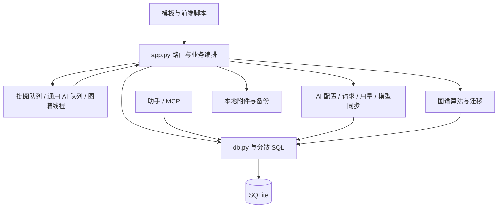
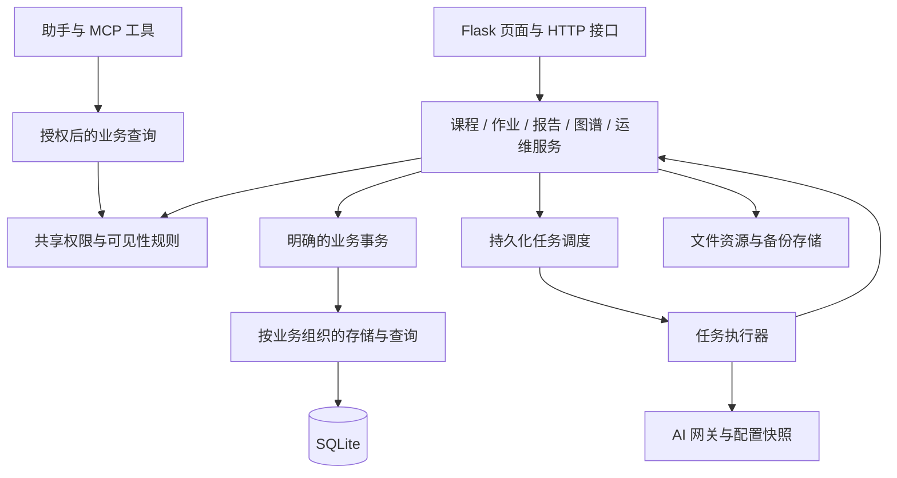

# GradeLogy 代码审阅与解耦重构建议

> 历史审阅报告：下文证据与行号对应原始基准提交。R01–R11 已完成本地修复，当前验收与未完成工程项见 [本地维护记录](../docs/maintenance-progress.md)。

审阅日期：2026-11-18。仓库：`jezecheng/GradeLogy`，分支 `main`，基准提交 `a49481740f0395c6a870111e9b3042abdfaabe1b`。

## 1. 审阅结论

项目已经形成完整的教学工作流，适合继续演进。需要优先处理的是权限边界、发布状态、恢复备份和图谱回滚的数据一致性，然后逐步建立清晰的模块边界。建议采用**模块化单体**：先保留 Flask、SQLite 和现有页面，按业务拆分职责。当前没有证据支持立即引入微服务或整体重写。

本次通过隔离验证确认 **11 类缺陷，涉及 12 个验证场景**。其中 6 类列为 P1，5 类列为 P2；另有静态审阅发现的工程风险，单独列出，未与复现结果混计。现有 **240 项测试全部通过**，说明现有测试对这些边界情况覆盖不足，不能据此判断系统已无重要缺陷。

本次没有修改业务代码、现有数据或部署配置，没有提交或推送到 GitHub。仅新增本报告；隔离验证脚本、结果和测试日志保存在被 Git 忽略的 `data/review/`。此前运行环境配置产生的 `run-local.sh` 和 `docs/local-development.md` 仍为未提交文件。

## 2. 范围、方法和验证边界

审阅覆盖后端生产模块、数据库定义与迁移、模板和自有前端脚本、现有测试、使用文档、Docker 与部署流程。逐条追踪了登录与角色、课程与名单、附件、作业批阅与复核、报告、学习诊断、知识图谱、AI 配置与用量、后台任务、备份恢复和导入导出的主要调用路径。第三方库内部代码不在本次逐行审阅范围。

| 代码规模 | 数量 |
| --- | ---: |
| 生产 Python 模块，包括包初始化文件 | 25 |
| 生产 Python 行数，含注释与空行 | 15,309 |
| 带路由装饰器的函数 | 133 |
| Python 中数据库执行调用位置 | 577 |
| `app.py` 行数 | 6,082 |
| `app.py` 带路由装饰器的函数 | 122 |
| `app.py` 数据库执行调用位置 | 306 |

以上是静态计数，不是复杂度评分或覆盖率；同一函数可对应多个 URL。

验证环境为本地 Python 3.12.16 与项目虚拟环境。现有测试再次执行：`AUTO_MODEL_SYNC=0 AUTO_BACKUP=0 AUTO_GRADE=0 .venv/bin/python -m unittest discover -s tests -v`，结果为 **240 tests，3.903 秒，OK**；依赖一致性检查通过。缺陷验证使用临时数据库、临时附件目录和 Flask 测试客户端，AI 返回通过模拟提供，未调用真实 AI，也未操作本地运行应用的数据。

没有执行生产部署、真实模型端到端批阅、实际费用核对、浏览器交互与移动端视觉验收、持续负载测试或联网依赖漏洞审计。HTML 注入已验证生成结果及解析后的属性，未在浏览器内执行攻击脚本。以下严重级别基于代码行为及实际触发条件，不代表已经发生线上事故。

## 3. 已确认的缺陷

P1：涉及访问隔离、未审核内容公开、身份混淆或数据丢失，应在大规模重构前修复。P2：影响正确性和工程可靠性，应安排近期修复。编号可用于后续跟踪。

| 编号 | 优先级 | 问题 | 隔离验证结果 |
| --- | --- | --- | --- |
| R01 | P1 | 教师附件下载缺少课程/图谱权限检查 | 无关教师取得另一课程附件，HTTP 200 |
| R02 | P1 | 学生纵向分析查询没有课程范围 | A 课程教师看到 B 课程分析内容 |
| R03 | P1 | 恢复备份后旧会话可映射到不同账号 | 同一教师 Cookie 从管理员页 403 变为 200 |
| R04 | P1 | 重新批阅保留旧发布标记 | 学生看到新的未复核逐题评语 |
| R05 | P1 | Markdown 链接可注入 HTML 事件属性 | 生成链接包含 `onmouseover` 属性 |
| R06 | P1 | 图谱回滚覆盖后续建图成果 | 节点从 2 个变为 1 个，后续资料仍存在 |
| R07 | P2 | 删除与移出课程清理不完整 | 残留薄弱点/复习标记；删除讲次留下孤儿题目 |
| R08 | P2 | 报告提示词关联错误 | A 课程作业收到 B 课程报告提示词 |
| R09 | P2 | AI 任务先标成功、后写入结果 | 写入失败，但任务仍显示 success |
| R10 | P2 | 环境 AI 配置覆盖不成套 | 环境接口与密钥搭配数据库模型名 |
| R11 | P2 | 应用工厂不能重复创建实例 | 第二次 `create_app()` 抛出路由覆盖异常 |

### R01 — 教师可以下载不属于其访问范围的附件

位置：[app.py:5932](/Users/I064388/Documents/ChatGPT/GradeLogy/app.py:5932)。

`uploaded_file()` 只对学生调用 `_student_files()` 检查；其他已登录角色直接进入文件读取。验证中，教师 B 没有课程 A 的授课关系，却能请求已知路径 `/files/course_10/answer.pdf`，得到 HTTP 200 和附件正文。目录越界检查仍在，因此这里不是任意服务器文件读取；触发前提是知道附件相对路径。随机文件名也不能替代访问权限。`meta` 和逐页预览分支共用此缺口。

建议：建立附件记录及所属资源关系，统一按课程成员、学生所有权、图谱协作权限或管理员权限授权后再读取。原件、元信息和裁剪预览都使用同一策略。增加跨课程教师、只读图谱成员、退出成员的访问测试。

### R02 — 纵向学情分析会跨课程显示

位置：[app.py:2210](/Users/I064388/Documents/ChatGPT/GradeLogy/app.py:2210)、[utilities/tags.py:292](/Users/I064388/Documents/ChatGPT/GradeLogy/utilities/tags.py:292)。

学生详情页已验证当前课程权限，但查询纵向分析时只传 `student_id`。同一个学生选修多个课程时，最新分析可能属于另一门课程。验证中，教师 A 打开自己的课程学生页，页面出现 B 课程私有分析标记。

建议：将课程范围纳入纵向分析的必需查询条件，保存和读取统一使用 `(course_id, student_id)`。检查页面、助手工具及所有同类查询，避免只在单个页面补条件。回归测试应使用同一学生同时选修两门课程的夹具。

### R03 — 恢复备份没有使所有旧登录会话失效

位置：[app.py:659](/Users/I064388/Documents/ChatGPT/GradeLogy/app.py:659)、[app.py:5695](/Users/I064388/Documents/ChatGPT/GradeLogy/app.py:5695)。

登录 Cookie 记录 `uid`；每次请求按恢复后的数据库读取这个编号。恢复只清空执行恢复操作的浏览器会话，当前系统签名密钥仍可保持不变。若备份中同一编号对应另一个账号，旧 Cookie 就以新账号身份继续有效。验证将原教师编号对应为恢复后的管理员：原教师 Cookie 访问管理员用户页，恢复前 403，恢复后 200，期间没有重新登录。

这也与管理员手册“恢复后所有人需要重新登录”的描述不一致。

建议：建立实例级会话失效版本，在恢复时整体更新，并在每次请求验证；其权威状态应避免被恢复包回退。设计要覆盖环境变量固定密钥、多个工作进程和恢复失败流程。密码重置、敏感角色变更也应有明确的会话撤销策略。只增加一次 `session.clear()` 不能解决其他浏览器已有会话。

### R04 — 重新批阅绕过新结果的审核与发布边界

位置：[app.py:2369](/Users/I064388/Documents/ChatGPT/GradeLogy/app.py:2369)、[app.py:4442](/Users/I064388/Documents/ChatGPT/GradeLogy/app.py:4442)。

`_save_grading_result()` 替换题目并把状态设置为“待批改”，但保留此前的 `report_published=1`。学生端按“已批改或者报告已发布”决定是否公开逐题内容。验证先准备已发布记录，再保存新的 AI 批阅结果；学生页随即显示新的未复核评语，发布标记仍为 1。错题本和学习助手存在相同的可见性判断，单修页面不够。旧报告和新题目也可能暂时混用。

建议：为每次批阅建立结果版本，分别记录草稿、复核和发布版本。重新批阅应生成新草稿，旧公开版本是否保留由产品规则决定；不能让旧发布标记自动授权新内容。短期修复至少在原子写入中重置关联发布状态并处理旧派生内容，所有读取入口共享可见性规则。

### R05 — 报告 Markdown 链接渲染存在事件属性注入

位置：[utilities/report.py:184](/Users/I064388/Documents/ChatGPT/GradeLogy/utilities/report.py:184)、[templates/report.html:37](/Users/I064388/Documents/ChatGPT/GradeLogy/templates/report.html:37)。

当前渲染器转义 `&<>`，却把链接 URL 直接拼入双引号包围的 `href`，未转义引号或限制协议；报告 HTML 被标记为安全内容。隔离输入 `[review](https://example.invalid/"onmouseover="window.reviewProbe=1)` 后，标准 HTML 解析器读出独立的 `onmouseover` 属性。安全响应头允许内联脚本，因此不能依靠现有 CSP 阻止该事件。

这里已确认 HTML 属性注入，浏览器脚本执行风险来自该生成结果；本次没有执行浏览器攻击。报告内容可能来自教师编辑或模型输出，应统一视为不可信内容。

建议：使用成熟的 Markdown 渲染与 HTML 白名单清理方案；限制 URL 协议，正确进行属性转义，兼容必要的 MathML 白名单。逐步移除内联事件后再收紧 CSP。测试覆盖引号、危险协议、嵌套链接、模型返回文本及数学公式，不能只检查是否出现 `<script>`。

### R06 — 图谱回滚会丢弃后续非同类修改

位置：[app.py:4186](/Users/I064388/Documents/ChatGPT/GradeLogy/app.py:4186)、[utilities/knowledge_graph.py:1208](/Users/I064388/Documents/ChatGPT/GradeLogy/utilities/knowledge_graph.py:1208)。

分类回滚只检查后面是否应用过另一条分类操作；图谱体检回滚有类似的同类历史限制。底层恢复却删除当前图谱所有节点和边，然后恢复整图快照。之后上传建图、手工改边或另一类体检修改没有被这一检查覆盖。验证在分类操作后新增资料与节点，再回滚：节点数 2→1，新资料仍在，建图成果丢失。

建议：所有图谱变更统一递增 revision，预览应用和回滚都验证版本；优先记录本次操作的差量与逆操作。确需整图恢复时，应拒绝覆盖已发生后续修改的图谱，并提供明确的人工处理路径。需要测试“分类→上传→回滚”“体检→分类→回滚”和并发编辑。

### R07 — 数据删除规则分散，留下残留和孤儿记录

位置：[app.py:1504](/Users/I064388/Documents/ChatGPT/GradeLogy/app.py:1504)、[app.py:2158](/Users/I064388/Documents/ChatGPT/GradeLogy/app.py:2158)、[db.py:382](/Users/I064388/Documents/ChatGPT/GradeLogy/db.py:382)。

移出学生会删除提交、题目、考试成绩和选课关系，但没有同步删除薄弱点与错题复习标记。验证移出后，选课关系为 0，薄弱点与复习标记各残留 1 条，学生仍能在薄弱点页看到原课程记录。删除讲次只删除提交和讲次，验证后残留 1 条孤儿题目。连接未启用 SQLite 外键约束；现有 `REFERENCES` 也没有普遍定义级联删除，不能自动兜底。

建议：先明确不同数据的保留规则，再建立统一的课程、讲次、账号删除服务。涉及教学记录的清理在一个事务完成，文件通过可重试清理任务处理。启用外键前须清理旧孤儿数据、补全删除语义并检查所有连接入口，不能直接打开开关而忽略已有数据库。学生聚合查询也应明确是否要求当前选课关系。

### R08 — 报告生成可能采用错误课程的提示词

位置：[app.py:4564](/Users/I064388/Documents/ChatGPT/GradeLogy/app.py:4564)。

报告提示词查询使用 `JOIN lectures l ON l.id=c.id`，错误地把讲次编号当作课程编号关联。讲次 20 属于课程 10，而另一课程编号恰好为 20 时，会取另一课程的提示词；不存在对应课程时则错误回落默认。验证模型入口实际收到 `PROMPT_B`，预期为 `PROMPT_A`。

建议：改为按 `l.course_id=c.id` 关联，并集中实现“通过提交解析所属课程及配置”，避免批阅、报告、诊断各写一套关联。测试夹具应故意使讲次 ID 与所属课程 ID 不同。

### R09 — 后台任务显示成功时，业务结果可能尚未写入

位置：[app.py:1801](/Users/I064388/Documents/ChatGPT/GradeLogy/app.py:1801)、[ai_usage.py:156](/Users/I064388/Documents/ChatGPT/GradeLogy/ai_usage.py:156)。

标签生成先调用 `_finish_ai_operation(..., 'success')`，再删除/插入标签和提交事务。若后续写入异常，队列捕获异常时又尝试标记失败，但 operation 已设置 `finished=True`，后续完成调用会被忽略。验证通过数据库写入中止模拟故障，结果为 `operation_status=success`、`tags_written=0`。题目清单生成也存在先完成、后写入的顺序。

建议：统一任务生命周期；只有业务结果成功提交后才允许成功状态。最好让结果写入和任务成功标记处在同一业务事务，故障时先回滚，再独立记录失败。用量日志应明确独立事务边界，不能在业务流程中隐式提交其他未完成写入。

### R10 — AI 环境配置和数据库配置被混合使用

位置：[ai_config.py:73](/Users/I064388/Documents/ChatGPT/GradeLogy/ai_config.py:73)。

环境接管判断只覆盖接口地址和密钥，模型名仍优先取数据库激活密钥记录。验证同时设置环境接口、密钥、模型，并保留数据库模型：最终得到环境接口和数据库 `db-model`，而不是环境 `env-model`。这与 Compose 所述环境配置优先行为不一致，可能导致模型不可用或请求发送给非预期模型。

建议：一次性解析完整配置对象，明确来源及优先级，避免逐字段拼接不兼容的配置。对部分环境变量配置也应制定一致规则。测试完整环境覆盖、部分覆盖、无环境设置以及教师配置切换。

### R11 — 应用工厂依赖全局注册表，无法重复初始化

位置：[app.py:6031](/Users/I064388/Documents/ChatGPT/GradeLogy/app.py:6031)。

`create_app()` 每次向全局 `_routes` 注册新 AI 视图函数。第二次创建时，重复 endpoint 对应不同函数，触发 `AssertionError: View function mapping is overwriting an existing endpoint function: admin_ai_usage`。模块导入还会创建全局 app、迁移数据库和启动后台线程；签名器及后台服务也依赖全局对象。

默认单实例运行未必立即触发这个异常，但它阻止可靠的多实例测试、独立配置和生命周期管理，是系统级解耦的实际障碍。

建议：每个实例独立构造路由/Blueprint、配置和扩展；工厂接受配置覆盖；迁移和 worker 启动作为显式入口。逐步通过 `current_app` 或明确注入的服务访问实例依赖，不再用全局 app 或为兼容测试而查找模块全局函数。

## 4. 静态审阅发现的工程风险

以下有明确代码依据，但本次未进行相应生产环境故障或压力复现，应作为设计和验证事项。

| 领域 | 现状与影响 | 建议 |
| --- | --- | --- |
| 在线恢复的一致性 | 数据库覆盖、附件移动和迁移是多个步骤；没有统一维护入口、worker 排空或自动恢复原状态。中途失败可能形成新数据库配旧附件；并发任务可能继续写入恢复后的编号 | 恢复前验证与演练、阻止新写入、排空任务、切换数据世代，失败回退；分阶段记录状态 |
| 备份一致性 | SQLite 在线备份可以保证数据库快照，但随后遍历附件不等于数据库与文件处于同一时间点 | 明确一致性承诺；用不可变附件、资源清单和校验值，或在短暂写入冻结中建立快照 |
| 任务恢复 | `db.init_db()` 无条件将所有 queued/running 操作改为失败，不检查 worker 所有者或租约 | 分离迁移与任务恢复，按 owner/lease/heartbeat 判断失联任务 |
| 多进程扩展 | 普通 AI 与批阅去重主要使用进程内集合和线程池；图谱工作也依赖进程锁。增加 worker 会改变执行语义 | 当前保留默认单进程；扩展前建立数据库原子认领、幂等键与租约 |
| 图谱任务容量 | 每份资料可创建等待全局锁的后台线程，缺少统一有界队列和停止排空机制 | 统一调度、容量限制、取消与关闭协议，保留现有 chunk 续建能力 |
| 图谱迁移格式 | `kg_transfer._DATA_TABLES` 包含 audits，未包含新表 `kg_category_maps`；独立图谱迁移不会带走分类操作历史及回滚快照 | 明确包格式版本、补迁移契约和兼容测试。整站数据库备份不受此特定遗漏影响 |
| 配置与费用归属 | 学生/管理员助手可通过默认解析选择已配置教师入口；价格以模型名为主键，跨供应商同名与计费时段需要明确 | 独立平台 AI 配置与费用归属，配置不可变快照；价格按提供商、模型和生效期管理 |
| 发布流程 | GitHub Actions 的 check 仅检查部署密钥，main 推送后直接构建部署；健康失败会报错，没有自动回滚 | 测试先于部署；发布绑定提交/镜像版本，失败恢复上一版本，数据库迁移另有兼容策略 |
| 构建可重现性 | requirements 只有最低版本，基础镜像也会变化；本地安装快照被忽略 | 保存可审阅的依赖锁定方案、明确更新策略，固定发布构建输入 |
| 前端交互 | 多个模板包含较长脚本，发布规则在前后端重复；图谱抽屉异步加载没有像 scope 查询一样防止旧响应覆盖新选择 | 按页面职责抽取脚本，建立统一请求与状态处理；增加关键浏览器流程验证 |
| 平台兼容 | `fcntl` 在应用/队列/模型同步模块直接导入，原生 Windows Python 不兼容 | 明确支持 macOS/Linux 或提供锁适配。Windows 的 Docker 部署运行 Linux 容器，不属于这个缺口 |

健康检查当前只验证数据库查询和目录可写，不能证明任务执行、报告正确性或数据库与附件关系完整；应与业务冒烟检查配合。

## 5. 当前模块职责与耦合

| 模块/区域 | 当前职责 | 重构判断 |
| --- | --- | --- |
| `app.py` | 生命周期、安全、用户、课程、名单、讲次、考试、批阅、图谱、报告、学生学习、备份及大量 SQL | 最大拆分入口，需沿业务路径迁移 |
| `db.py` | Schema、补列迁移、初始化账号、连接管理、任务重启处理 | 分离连接、版本化迁移、种子数据和运行期任务恢复 |
| `config.py` | 环境配置、目录、日志初始化 | 配置实例化；日志/目录操作从读取配置中分离 |
| `ai_config.py` / `ai_routes.py` | AI 设置解析、管理页面与探测 | 已有抽离基础，需完整配置对象和稳定服务接口 |
| `ai_usage.py` / `model_catalog.py` | 操作/请求用量、预估费用、模型目录及同步 | 拆分计量、价格策略、目录同步生命周期 |
| `grading_service.py` / `utilities/ai_task_queue.py` | 批阅与通用 AI 调度 | 保留注入思路，统一任务状态与持久化调度 |
| `utilities/pdfgrade.py` / `llm.py` | PDF/图片转输入、提示词、结果解析、模型请求 | 建立 AI 网关和类型化结果；素材处理与业务解析分开 |
| `utilities/report.py` / `tags.py` | 报告渲染、知识标签和诊断统计 | 渲染安全优先；将诊断范围与发布版本显式化 |
| `utilities/knowledge_graph.py` | 提取、增量合并、防环、布局、体检和分类 | 保留纯算法，拆分建图编排与图谱修订服务 |
| `utilities/kg_transfer.py` / `kg_cli.py` | 图谱包校验、导入导出和命令行 | 是值得保留的边界，补格式版本及新表契约 |
| `utilities/assistant.py` / `mcp_server.py` | 按角色查询教学数据、工具调用和说明检索 | 应调用共享查询/权限服务，避免复制 SQL 与状态规则 |
| `utilities/roster.py` / `course_export.py` | CSV 解析、用户名生成、课程包组装 | 相对纯粹，可保留独立测试与调用方式 |
| `utilities/uploads.py` / `kg_text.py` / `storage.py` / `logview.py` | 附件迁移/命名、提取、大小显示、日志读取 | 逐步建立文件资源和存储接口，避免散落路径拼接 |
| `templates/` / `static/` | 页面、上传草稿、PDF 面板、轮询、助手和星图 | 先稳定服务与接口，再迁移脚本，无需先换前端框架 |
| Docker / deploy / GitHub Actions | 单进程多线程运行、数据卷、更新和健康检查 | 保持可用部署路径，增加测试门禁与可回退发布 |

当前依赖关系大致如下：

关键问题不是单个文件行数，而是业务规则存在多个入口、事务由不同层提交、后台任务依赖全局应用，以及资源修改缺少统一版本。只把 `app.py` 按行数拆成几个文件会保留这些问题。

## 6. 建议的目标结构

采用按业务组织的模块，每个模块内部有 HTTP 适配、应用服务、查询/存储层。先使用简单明确的 Python 接口；避免为所有函数增加抽象类。

建议业务边界：

- **身份与权限**：登录、会话失效、角色、课程成员、图谱成员。HTTP、助手和任务都使用同一授权依据。
- **课程与教学资料**：课程、名单、讲次、教案、考试及附件所属关系。
- **作业与批阅**：提交、输入素材、批阅结果版本、人工复核、任务编排。
- **报告与学习诊断**：公开版本、报告生成、横纵分析、薄弱点与错题复习。
- **知识图谱**：资料提取、chunk 构建、节点/边算法、修订历史、体检/分类、迁移。
- **AI 基础设施**：配置快照、请求、重试、超时、结果解析、用量与价格，不决定课程权限或发布规则。
- **系统运维**：迁移、备份、恢复、数据一致性检查、日志与健康检查。

必须先建立的共同规则：

1. 所有资源读取都具有明确作用域；禁止业务层只接收一个裸学生 ID 就返回跨课程敏感数据。
2. 发布绑定结果版本；草稿更新不自动改变学生已公开内容。
3. AI 调用不长时间占用写事务；调用前固定输入版本，返回后验证资源版本再提交。
4. 服务拥有业务事务，底层辅助函数不隐式提交调用者事务。用量日志有独立且明确的持久化协议。
5. 任务状态和业务结果一致，幂等键以操作资源及输入版本为依据；失败/重启允许可预测恢复。
6. 图谱每次变更都参与 revision 检查；回滚不能默默覆盖其他操作。
7. 数据库和文件变更有一致性清单、恢复步骤及故障补偿；数据库事务不会自动回滚文件操作。

## 7. 分阶段实施顺序与验收

不要在同一次大改中混合权限修复、目录搬迁、数据库替换和前端重写。每一步以可独立验证的小提交或 PR 完成。

| 阶段 | 工作范围 | 完成条件 |
| --- | --- | --- |
| 0：正确性基线 | 修复 R01–R06；尽早修复 R07–R10；将隔离场景转为正式回归测试 | 现有测试通过；跨课程/恢复身份/新草稿/回滚覆盖的测试通过；真实旧库演练可恢复 |
| 1：生命周期与配置 | 修复 R11，真正的应用工厂、独立实例配置、显式迁移与 worker 入口 | 同进程创建两个独立应用互不干扰；单纯导入不启动任务；默认运行命令仍可用 |
| 2：一个完整业务切片 | 从课程/讲次授权和附件服务开始，再迁移作业复核与发布 | 页面和助手调用共享规则；现有 URL/响应/数据兼容；没有新的跨模块循环依赖 |
| 3：事务与数据迁移 | 统一连接与事务约定；版本化迁移；删除策略、外键与旧孤儿数据治理 | 新库、旧库、备份恢复均验证；注入写入失败时没有半完成状态；清理规则可审阅 |
| 4：任务与图谱修订 | 统一任务生命周期、数据库认领/租约、输入版本、图谱 revision 与安全回滚 | 重复请求不产生重复结果；进程中断、过期任务、晚到 AI 结果和混合回滚均可预测 |
| 5：前端与发布工程 | 页面脚本抽取、轮询一致性、浏览器核心流程、依赖锁定、CI 和回滚 | 教师批阅→复核→发布→学生查看流程通过；失败版本不进入部署或可恢复 |

阶段可以适度交错，但权限、发布和备份安全应先于大规模迁移。每次结构调整都要保持行为契约；已经确认的错误通过单独缺陷修复更正，不能把错误行为固化为重构兼容目标。

初期继续使用 SQLite：当前默认部署是一进程八线程，尚未测量出必须换数据库的容量瓶颈。先完成正确性、索引/查询观察和压力测试，再决定是否需要 PostgreSQL。任务持久化也可以先通过 SQLite 的原子事务和租约实现，只有运行规模要求时才引入额外队列服务。

## 8. 测试补强重点

现有测试在图谱增量合并、防环、chunk 续建、角色工具、名单解析和部分权限检查上已有有用基础，应保留。部分测试用同步队列替代真实后台执行，能验证业务结果，但不能证明线程调度、完成时机或进程恢复正确。

需要增加的高价值测试：

- 角色与资源矩阵：管理员、授课教师、无关教师、图谱管理/编辑/使用成员、在课学生、退出学生；覆盖页面、附件、预览、助手与后台请求。
- 发布状态转换：首次批阅、复核、公开、重新批阅、重新生成报告、撤回公开；同时断言页面、错题本与助手的内容版本。
- 多课程夹具：同一学生两课程，刻意错开课程/讲次 ID，确保分析与提示词范围正确。
- 故障边界：模型成功后数据库失败、附件切换失败、恢复迁移失败、任务超时/中断、删除资源后的晚到结果。
- 图谱修订：分类、体检、上传、改边交错；过期预览不得应用，旧回滚不得删除新成果。
- 持久化生命周期：重复实例、不同配置、真实异步完成、worker 重启；多进程支持仅在相关测试通过后宣称。
- 迁移与恢复：至少保存代表性旧版本数据库/包的匿名夹具，验证 schema、附件及会话失效规则。
- 渲染安全与核心浏览器流程：报告链接和公式、上传草稿、PDF 预览、任务轮询、图谱快速切换。

测试成功应对应业务不变量，避免只断言“页面返回 200”或复制实现内部步骤。本次没有测量覆盖率，不提供推测百分比。

## 9. 后续建议

下一轮最有价值的工作是先修复权限、会话、发布和图谱回滚六类 P1 问题并补回归测试，再进行应用工厂与业务服务解耦。正式改动前应确定两项产品规则：重新批阅时旧公开版本是否继续可见；移出课程时哪些学习记录需要保留。其余多数工程步骤可以依据现有行为和上述验收条件推进。

本报告是当前提交上的代码与架构审阅结果，不是生产系统安全认证或性能承诺。后续重构应通过每阶段的兼容与故障测试逐步证明可靠性。
